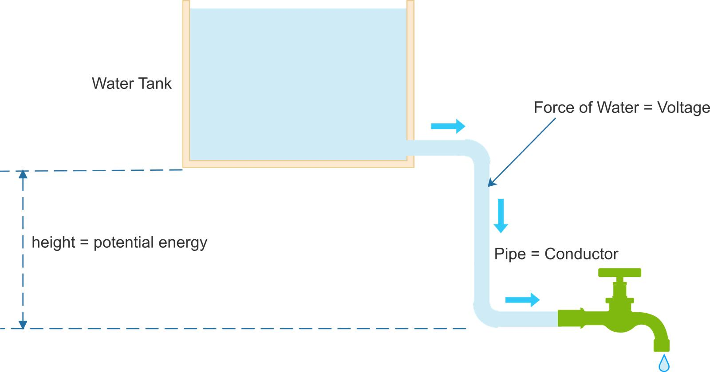
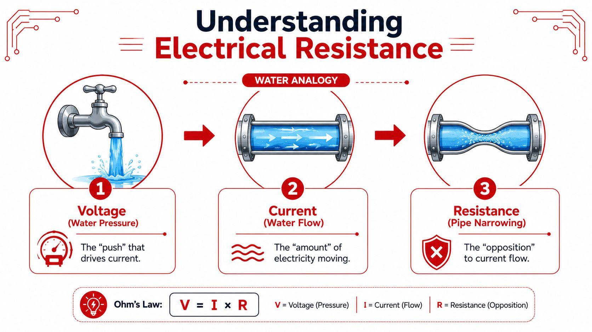

## 01_Basic_Electrical_Concepts

### Understanding electricity:
Imagine a small battery and a light bulb.

When the battery is connected to the bulb using wires, then the bulb lights up. Because the battery provides the electrical energy that makes electric current flow through the circuit.

There are three basic concepts to understand: 

-   1. Voltage (V)
-   2. Current (I)
-   3. Resistance (R)
-   4. VDD and GND

### Voltage (V):
Imagine a water tank:

Think of voltage as ***electrical pressure*** that drives current through a circuit. **Voltage tells us how much electrical potential difference exists between two points.**

    -   Voltage is measured in Volts (V).
    -   A battery provides a voltage.
    -   STM32 board has a 3.3 V power supply.

For example, in STM32F407VG board circuit:

- VDD = 3.3 V (positive supply).
- GND = 0 V (reference point).
So the voltage difference between VDD and GND is 3.3 V.

### 2. Current (I):
Current is the flow of electric charge through a circuit. Think of water flowing through a pipe.

- Current is measured in Amperes (A).
- The symbol used for current is I.

### 3. Resistance (R):
Resistance opposes the flow of electric current. 

Imagine a water pipe that becomes narrower. It restricts the water flow. Similarly, a resistor restricts electrical current.

- Resistance is measured in Ohms (Ω).
- The symbol used for resistance is R.

### 4. VDD and GND:
Names frequently seen in electronic circuit diagrams.

|Term	| Meaning |
|-------|---------|
|VDD	| Positive power supply |
|GND	| Ground, the circuit's 0 V reference |

For STM32 board:
- VDD is approximately 3.3 V.
- GND is 0 V.

The voltage difference between them is 3.3 V.