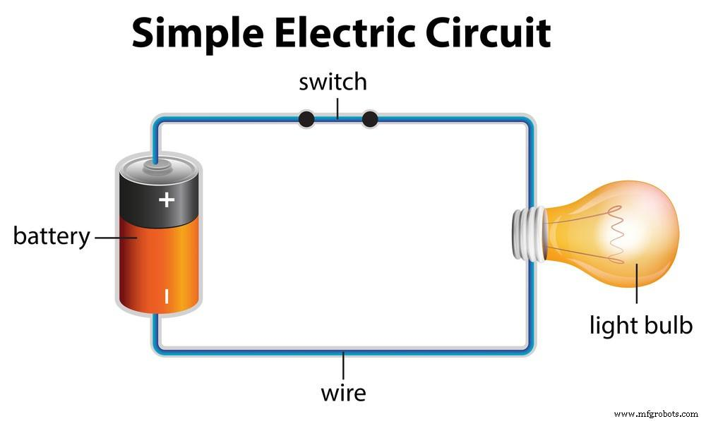
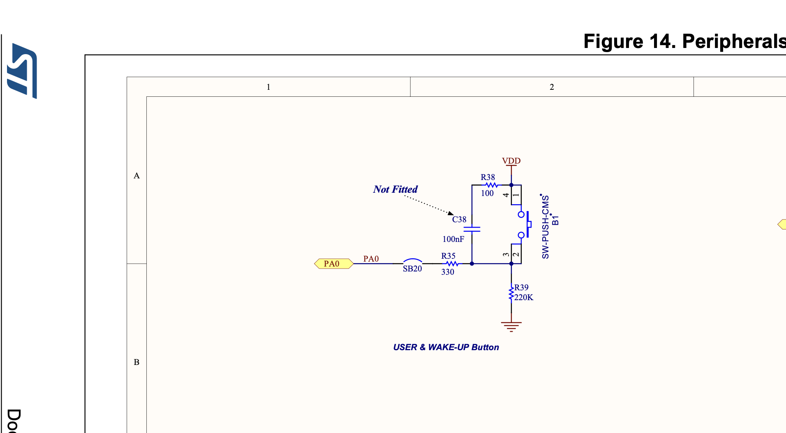
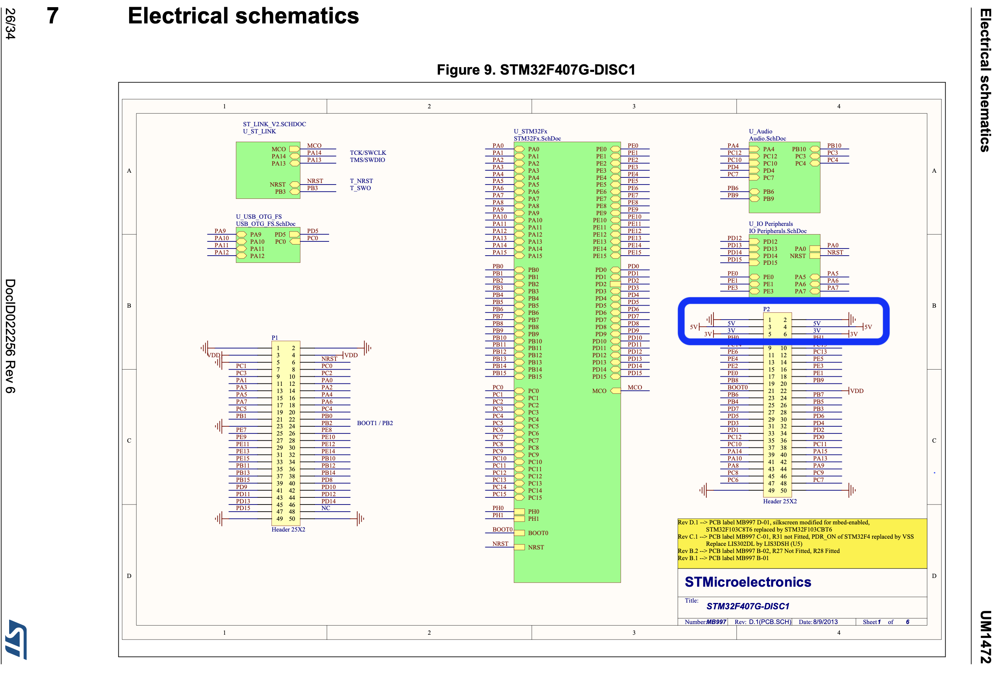

## 01_Basic_Electrical_Concepts

### Understanding electricity:
Imagine a small battery and a light bulb.



When the battery and bulb are connected using wires to form a closed circuit, current flows and the bulb lights up. The battery provides energy to the circuit and maintains a voltage across its terminals.

There are few basic concepts to understand: 

-   1. Voltage (V)
-   2. Current (I)
-   3. Resistance (R)
-   4. VDD and GND

### Voltage (V):
Imagine a water tank:


Think of voltage as ***electrical potential difference (electrical pressure is an analogy)*** that can drive current through a circuit. **Voltage tells us how much electrical potential difference exists between two points.**

    -   Voltage (V) – electrical potential difference.
    -   Voltage is measured in Volts (V).
    -   A battery provides a voltage (it maintains a potential difference between its terminals).
    -   The STM32F407G DISC1 board provides a nominal 3 V output (usually measured close to 3.0 V); VDD is the positive supply connection of the MCU. Its actual voltage depends on the board's power-supply design and configuration.
    -   Voltage is always measured between two points. For example, V = V(VDD) - V(GND).

For example, in STM32F407VG board circuit:

- P2 pin 5 and P2 pin 6 = 3V supply output.
- P2 pin 1 and P2 pin 2 = GND 0 V (reference point).

So the voltage difference between pin 5 of P2 and GND should be approximately 3 V. Voltage is always measured between two points. For this measurement, V = V(P2 pin 5) - V(GND) ≈ 3 V - 0 V = 3 V.


### 2. Current (I):
Current is the **rate of flow of electric charge through a circuit**. Think of water flowing through a pipe. In circuit diagrams, conventional current is shown flowing from higher potential to lower potential; in metal wires, electrons drift in the opposite direction.

- Current is measured in Amperes (A).
- The symbol used for current is I.

### 3. Resistance (R):
Resistance **opposes the flow of electric current.** For an ideal resistor, increasing resistance reduces current when the voltage stays the same.

Imagine a water pipe that becomes narrower. It restricts the water flow. Similarly, a resistor restricts electrical current.

- Resistance is measured in Ohms (Ω).
- The symbol used for resistance is R.


**Example 1:**

Imagine two identical circuits, both supplied with 3.3 V.
- Circuit 1 has a resistance of 100 Ω.
- Circuit 2 has a resistance of 1,000 Ω.

Which circuit allows more current to flow? Circuit 1 (100 Ω), because lower resistance allows more current to flow, when the voltage stays the same.

### 4. VDD and GND:
Names frequently seen in electronic circuit diagrams.

|Term	| Meaning |
|-------|---------|
|VDD	| Positive power supply |
|GND	| Ground, the circuit's 0 V reference |

VDD identifies the positive supply connection of the microcontroller. It is a connection name, not a fixed voltage value.

For STM32 board:
- P2 pins 5 and 6 are labeled 3V on this board. This is a nominal 3 V output, distinct from the MCU's VDD supply, which is nominally 3.3 V (P2 pin 22 is labelled VDD.)
- GND is 0 V.(P2 pins 1 and 2 are labelled GND.)

The voltage difference between P2's 3V pin and GND is nominally 3 V. VDD and GND in a schematic may refer to the MCU's 3.3 V supply and its reference, so check the specific points being discussed.

GND (Ground) is the reference point we treat as 0 V in a circuit. GND does not mean that electricity disappears or that current cannot flow. It is our reference point for measuring voltage.

The 3V and VDD labels are distinct connections in this schematic. We should check the board's power-supply circuitry before assuming they are electrically equivalent.

-       VDD tells the name/function of a power connection.
-       3V tells the nominal voltage associated with a particular supply output.
-       GND gives the voltage reference.

### 5. Ohm's Law:
```text
        V 
I =   ----
        R
```

The same relationship can be written as **V = I × R**. These equations describe an ideal resistor; real circuits may also include other components and power-supply limits.

Where:
- **I** = Current (Ampere)
- **V** = Voltage (Volt)
- **R** = Resistance (Ohm)
```text
         3.3V 
I =     ------   = 0.033A (amperes) = 33mA (milliamperes)
        100 Ω
```
```text
         3.3V 
I =     ------   = 0.0033A (amperes) = 3.3mA (milliamperes)
        1000 Ω
```

Let's calculate from Example 1:

|Circuit	| Voltage	| Resistance |	Current |
|-----------|-----------|------------|----------|
|1	        | 3.3 V	    | 100 Ω	     | 33 mA    |
|2	        | 3.3 V	    | 1,000 Ω	 | 3.3 mA   |

***When resistance increases 10 times, current decreases 10 times (with voltage unchanged).***

The UM1472 user manual, under Electrical schematics, shows the User & WAKE-UP Button B1 circuit, which is also considered in [02_01_Interrupts_NVIC_practicals.md](../../04_Interrupts_NVIC/02_01_Interrupts_NVIC_practicals.md).



It contains the below resistors, VDD and GND.
- R38: 100 Ω
- R39: 220 kΩ
- R35: 330 Ω
- C38 – 100 nF (Not Fitted)
These resistors have different jobs in the circuit. From the diagram, GND (ground) represents the reference point treated as 0 V in this circuit. **GND (ground) is the reference point we treat as 0 V.**

GND does not mean that electricity disappears or that current cannot flow. It is our reference point for measuring voltage.

On this board, the P2 pins labeled 3V provide approximately 3 V. The MCU's VDD supply is nominally 3.3 V; these labels refer to different rails. GND is the 0 V reference.

Voltage is always measured between two points. For example, at the MCU supply: V = V(VDD) - V(GND) ≈ 3.3 V - 0 V = 3.3 V.
So, the voltage difference between VDD and GND is approximately 3.3 V. We don't simply say a point has 3.3 V without specifying the reference point.

### Experiment 1: Measuring the voltage using Multimeter:

So on the schematic, these two labels VDD and GND tell where the circuit's positive supply and reference connections are. Let's measure the real voltage on the STM32F407G-DISC1 using a PCW01A digital multimeter. Figure 9: STM32F407G-DISC1, from Section 7, Electrical schematics of UM1472.



According to the schematic diagram, connector P2 has these pin connections:
- Pin 1 and pin 2 - GND
- Pin 3 and pin 4 - 5V
- Pin 5 and pin 6 - 3V

|**P2 pins**	|**Connection**	|**My measurement (PCW01A, DC voltage mode V⎓)** | **Comments** |
|---------------|---------------|---------------------------------------|--------------|
| Pin 1         |	GND	|       Reference                       |     -        |
| Pin 3	        |       5V	|       4.98V                          | V = 5V - GND = 4.98V (Close to nominal 5V)|
| Pin 5	        |       3V	|       2.98V                          | V = 3V - GND = 2.98V (Close to nominal 3V)|

### Understanding my multimeter measurements

I used a PCW01A digital multimeter in DC voltage mode (`V⎓`).

Probe connections:
- Black probe -> COM socket -> P2 pin 1 (GND).
- Red probe -> VΩ socket -> P2 pin 5 (3V).

The multimeter displayed 2.98 V.

The voltage calculation is: V(P2 pin 5) - V(P2 pin 1) = 2.98 V - 0 V = 2.98 V.

I also measured between P2 pin 1 (GND) and P2 pin 3 (5V).

The multimeter displayed 4.98 V.

**Important understanding:**

The black probe is connected to the COM socket, and the red probe is connected to the VΩ socket. They are not permanently assigned to GND and positive voltage.

For normal positive supply measurements:
- Black probe -> GND.
- Red probe -> positive supply.

**If the probes are reversed, the multimeter displays a negative voltage**, for example, -4.98 V or -2.98 V.
The voltage difference between them is 3.3 V.

