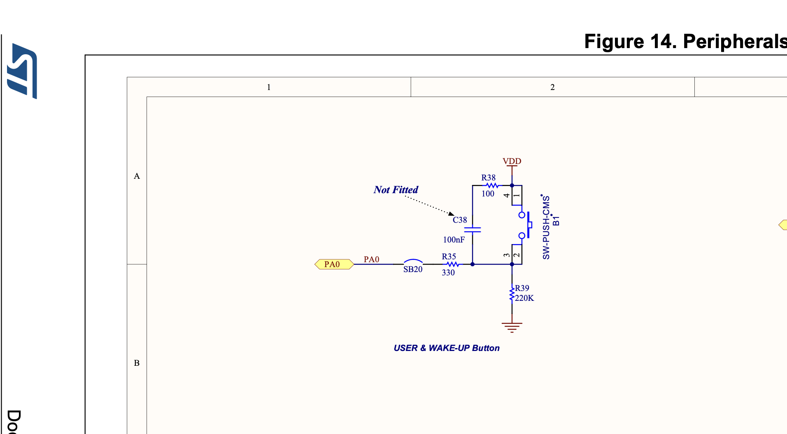
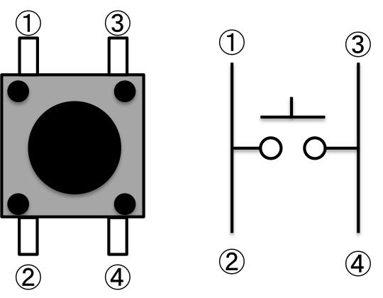

## 02_Reading_Electrical_Circuits.md

### User & Wake-Up Button (B1):

Let's return to the B1 User Button circuit on STM32F407VG DocID022256 Rev 6 UM1472. 

Components identified in the circuit:

|Component | Description |
|---------|-------------|
|B1       |  USER push-button |
|R38      |  100 Ω resistor |
|R39      |   220 kΩ resistor | 
|R35      |  330 Ω resistor |
|C38      |   100 nF capacitor (Not Fitted) |
|PA0      |  STM32 GPIO input pin (Port A Pin 0) |
|SB20     |   Solder bridge | 

### Capacitor (c) :
A capacitor is an electronic component that stores electrical charge temporarily. in the above image, C38 is a capacitor.
In the above circuit, C38 is a capacitor.
-   C: Component reference letter for a capacitor.
-   38: Component identification number.
-   100 nF: Capacitance value.
-   F (Farad): Unit used to measure capacitance.
-   Not Fitted: The PCB has a provision for this capacitor, but the component is not installed.

### Push-button switch (B1) :
SW-PUSH CMS represents the B1 push-button switch.
The numbers 1, 2, 3 and 4 are the switch's terminal numbers. They identify its electrical connection points. When the button is pressed, its internal contacts connect. When it is released, they disconnect.+
This is a Normally Open (NO) push-button switch. In its released state, the switch contacts are disconnected. When pressed, the contacts connect.
-   Released: Contacts disconnected -> Open circuit(There is no complete electrical path for current to flow through that switch).
-   Pressed: Contacts connected -> Closed circuit.(The electrical path is complete, so current can flow (if a voltage source is connected).

Looking at the Push button, it has 4 connection points / terminals. A typical four-pin tactile push button has two pairs of internally connected terminals.

-   Terminal 1 and terminal 2 are permanently connected internally(even when the button is released.)
-   Terminal 3 and terminal 4 are permanently connected internally(even when the button is released.)
When the button is pressed, the two pairs become electrically connected and when the button is released, these two pairs are disconnected from each other.
This is the typical arrangement for a four-pin tactile switch.The exact terminal numbering should be checked against the component's datasheet or schematic.

### Resistor (R) :
A resistor is an electronic component that opposes the flow of electrical current. Its resistance is measured in Ohms (Ω).

**Why is resistance important?**

Connecting VDD directly to GND using a wire with very little resistance can create a short circuit. A short circuit can cause excessive current to flow and potentially damage components, PCB tracks or the power supply.

When VDD and GND are connected directly with a wire:
-   There is a voltage difference between VDD and GND.
-   The wire has very little resistance which results in very large amount of current.
-   This excessive current can damage components, tracks or the power supply.

If the resistance is increased between VDD and GND while keeping the voltage constant then the current decreses. When voltage stays constant: (Ohms law : I = V / R)
- Higher resistance -> lower current.
- Lower resistance -> higher current.

A resistor can therefore be used to limit current. However, its actual function depends on where it is connected in the circuit.

### Solder bridge (SB20) :
**SB20 is a solder bridge, not a resistor. A solder bridge provides a way to connect or disconnect an electrical path on a PCB, depending on its configuration. In this circuit, SB20 is associated with the connection to PA0.

### Why is this circuit relevant to embedded software?

The B1 button provides a physical input to the STM32 microcontroller.

As embedded developers, we need to understand:
-   A push button can provide an input signal to a GPIO pin.PA0
-   A GPIO pin can be configured as an input.
-   The microcontroller can read the pin's logic level.
-   Firmware can respond when the button is pressed or released.