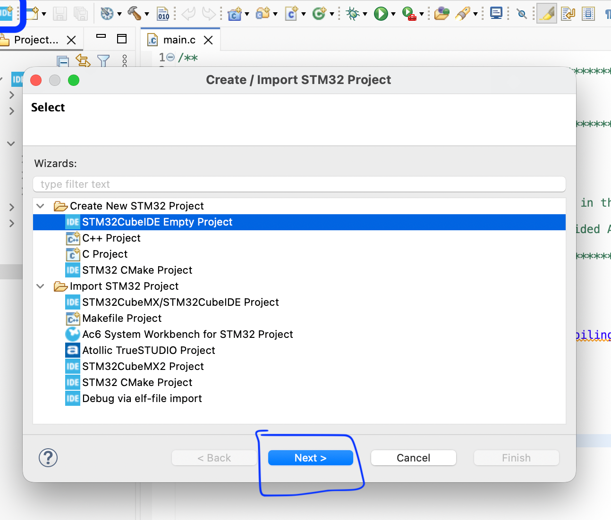
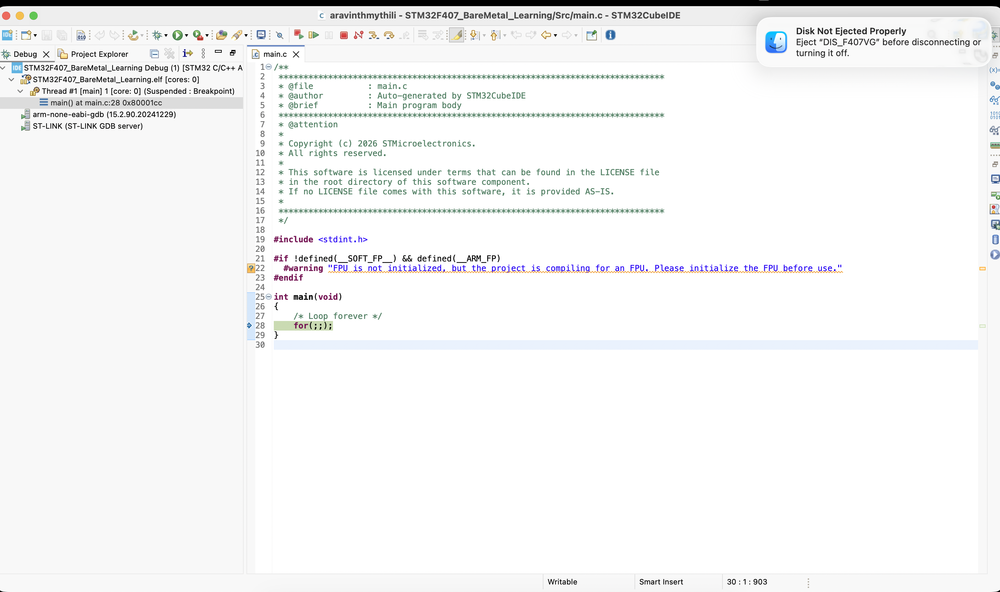
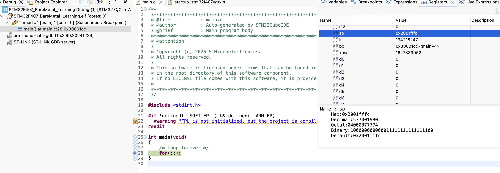
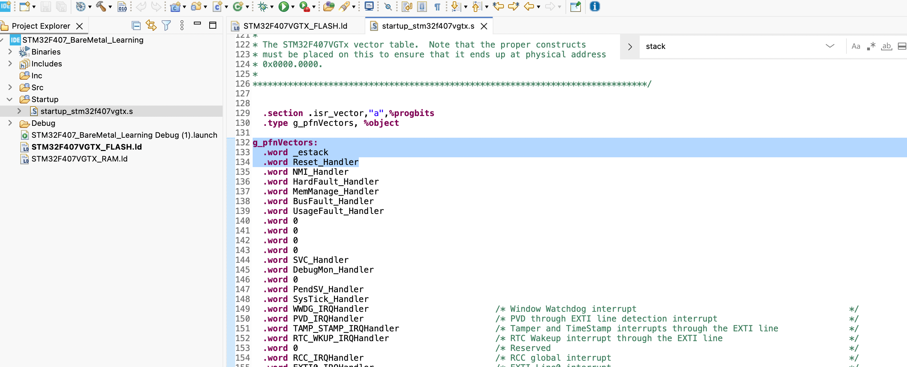
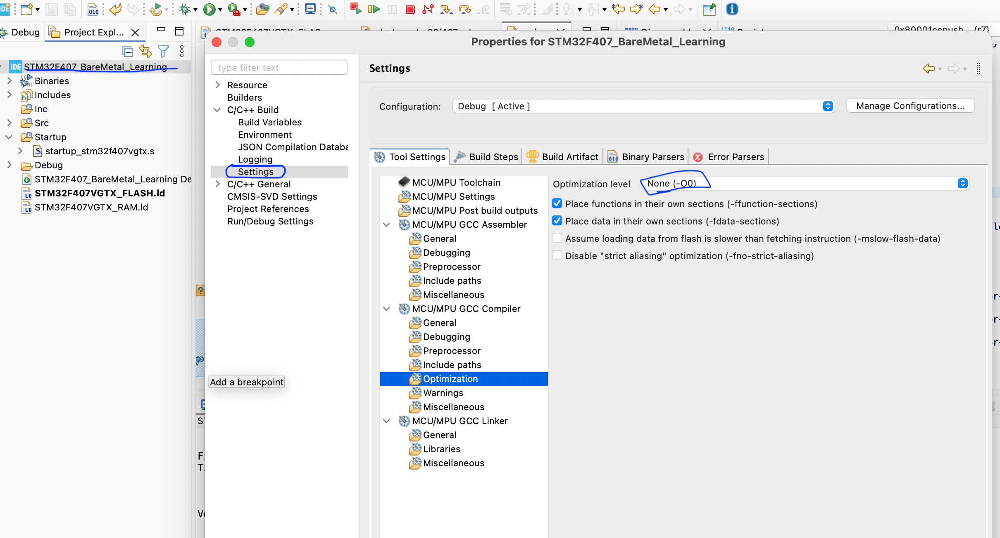
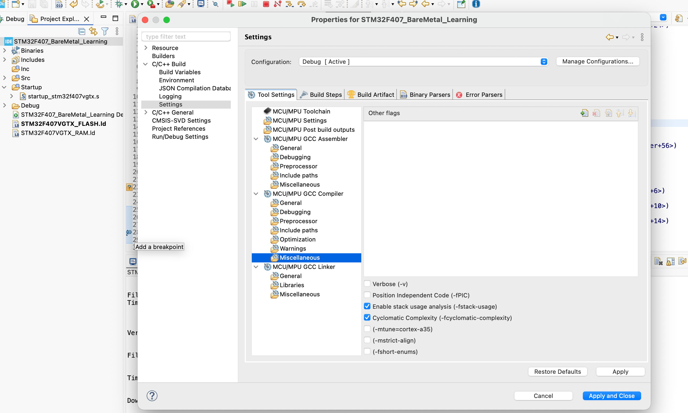
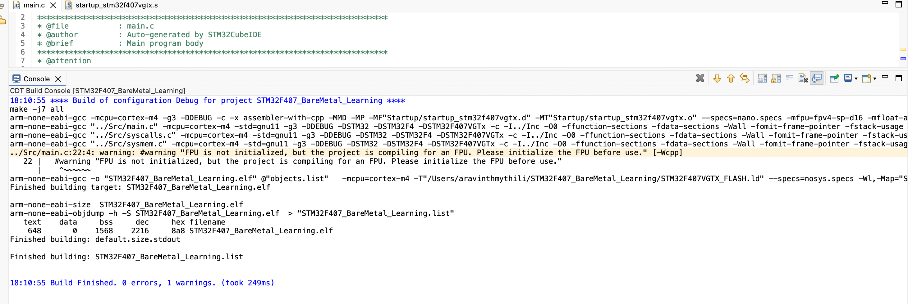
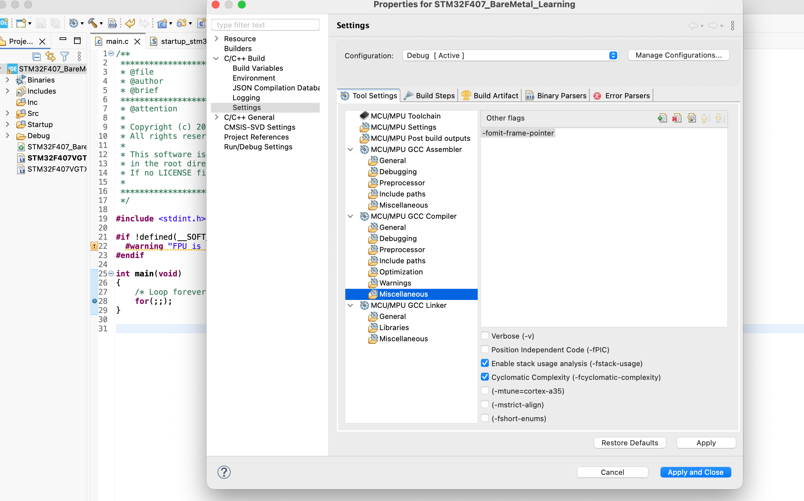
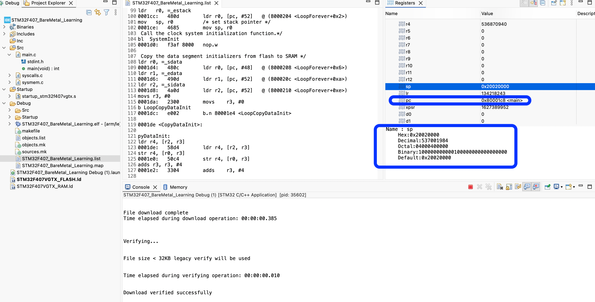
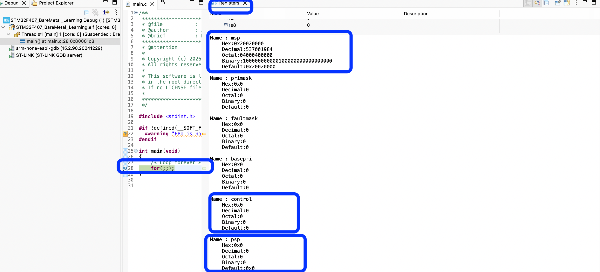

Cortex-M4 Core Registers — Practical Experiments

This document demonstrates the Cortex-M4 core registers through C, assembly, debugger inspection, and STM32F407 hardware experiments.

For the complete theory explanation of Cortex-M4 core registers, refer to [01_Cortex_M4_Core_Registers.md](01_Cortex_M4_Core_Registers.md).

## Creating a Bare-Metal Project and Connecting the Debugger
Date: 04 November 2026

### My setup

Development board : STM32F407G-DISC1
Microcontroller : STM32F407VG
IDE : STM32CubeIDE
Programming language : C
Programming approach : Bare-metal (no HAL / LL)
Debugger : Onboard ST-LINK
Debug interface : SWD

I am recording the board, MCU, IDE, and debug connection and the produced observations and connecting the theroy part with the praticals. The STM32F407G-DISC1 is the board; STM32F407VG is the MCU fitted to it. ST-LINK is the debug probe on the board, and SWD (Serial Wire Debug) is the two-wire debug interface used to communicate with the MCU.

---

### 1. What I wanted to achieve

I wanted to create a separate praticals for learning Cortex-M4. My intention was to connect my STM32F407 board to STM32CubeIDE, start a debugging session and inspect the actual CPU registers.

### 2. Creating my project

I opened STM32CubeIDE and followed these steps:

1. Click on the STM32 Project Create/Import icon -> Create New STM32 Project -> STM32CubeIDE Empty Project.
2. Searched for and selected my STM32F407VG microcontroller.
3. Named the project `STM32F407_BareMetal_Learning`.
4. Selected STM32CubeIDE as the toolchain.
5. Generated the project.

**Screenshot:** Project creation / MCU selection.


### 3. Checking the generated project

I opened `Core/Src/main.c`.

**Screenshot:** Generated `main.c` in the project.


The generated main function contained:

```c
int main(void)
{
    /* Loop forever */
    for(;;);
}
```
The processor remains in an infinite loop, continuously executing the loop instruction(s). This loop does not request sleep mode. I did not modify the code. I built the project using Project -> Build Project.

This is a minimal starting point: it gives the debugger a valid firmware image to load and run, without application code changing registers or peripherals. A successful build means the source compiled and linked into a firmware image; it does not by itself prove that the board was programmed or that the program behaves correctly on hardware.

**My observation:** Build finished successfully with no warnings.

### 4. Connecting my STM32F407 board and starting the debugger

I used the onboard ST-LINK debugger on the STM32F407G-DISC1. The USB connection carries the debugger communication between the computer and ST-LINK; ST-LINK then communicates with the MCU using SWD. I used the board's ST-LINK USB connector, rather than a USB connector intended for a different function on the board.

#### 4.1 Connect the board

1. I connected the board to my computer using the USB cable and the onboard ST-LINK USB connector.
2. I checked that the board was powered and that the ST-LINK connection was available to the computer. The debugger needs this physical connection before CubeIDE can connect to the MCU.
3. I kept the project built before starting the debug session. This gives CubeIDE a current firmware image to load. If I change the source later, I need to build again so the image matches the source I am looking at.

#### 4.2 Check the debug configuration

1. In CubeIDE, I opened **Run -> Debug Configurations...**.
2. In the left-hand list, I expanded **STM32 Cortex-M C/C++ Application** and selected the debug configuration for `STM32F407_BareMetal_Learning`. CubeIDE may create this configuration the first time I start debugging; the important part is to select the configuration associated with this project.
3. I opened its **Debugger** tab.
4. I checked the probe and interface settings:

   - **Debug probe:** ST-LINK (OpenOCD)
   - **Interface:** SWD

   ST-LINK identifies the debug hardware. OpenOCD is the debug server used by this setup to communicate with the probe. SWD is the debug interface between ST-LINK and the MCU. These settings must match the hardware connection, otherwise CubeIDE may fail to establish the session.

5. I clicked **Apply** to save the configuration, then clicked **Debug** to launch it.
6. If CubeIDE asked whether to switch to the Debug perspective, I accepted. A perspective is an IDE layout containing the views used for debugging; changing perspective does not change the firmware.

#### 4.6 If debugging does not work

If CubeIDE cannot connect to my board, I should check:

1. Is the USB cable connected to the ST-LINK connector?
2. Is the board powered?
3. Is the ST-LINK detected by the computer?
4. Is the correct project selected?
5. Is ST-LINK (OpenOCD) selected?
6. Is SWD selected as the debug interface?
7. Did the project build successfully?

If it still fails, I should record the exact error
message before changing debugger settings.


#### 4.3 What happens when debugging starts

CubeIDE starts the debug server, connects to ST-LINK, connects to the MCU through SWD, and loads the project's firmware image if the configuration is set to download it. It then halts the processor at a startup location or breakpoint so I can inspect it. The exact first halt location can depend on the debug configuration and startup code. A halted target is expected during debugging; it is not by itself a sign that the MCU is broken.

If the debugger does not connect, I should check the simple things first: the board is connected through the ST-LINK USB connector, the board is powered, the selected configuration belongs to this project, and the probe/interface still show ST-LINK and SWD. I should also read the CubeIDE error text, because a connection failure and a firmware/build failure are different problems.

#### 4.4 Confirm that the target is connected and halted

I checked the **Debug** view in the Debug perspective:

1. I looked for the `STM32F407_BareMetal_Learning` debug session and its STM32F407 target in the Debug window.
2. I checked the thread status. Mine showed `Suspended: Breakpoint`, meaning the processor was halted at a breakpoint and was not currently executing instructions.
3. I checked the editor for the execution arrow. Mine appeared at the infinite loop in `main()`.

These checks tell me the session attached to the target and execution is halted at the displayed source location. The source arrow is the debugger's best source-level mapping for the current instruction; optimized or startup code can sometimes make source mapping less direct. I should record the status and location together with any register value, because register values change while the processor runs.

**My observation:** The debugger connected successfully. The STM32F407 target appeared in the Debug window, the thread showed `Suspended: Breakpoint`, and the execution arrow appeared at the infinite loop in `main()`.

#### 4.5 Open the CPU Registers view

1. While the target was halted, I opened **Window -> Show View -> Other...**.
2. I expanded **Debug** and selected **Registers**.
3. In the Registers view, I located `SP` (also called `R13`). If the view is empty or says there is no active debug context, I first select the active target/thread in the Debug view. Register values are meaningful only for a selected target, and I should keep the target halted while recording them.

The Registers view shows the CPU state at the current halt. It is a snapshot: if I resume execution, the CPU can change registers before I halt it again. This is why I recorded the breakpoint status and source location along with SP.

### 5. CPU register inspection — SP

I opened the Registers view: Window -> Show View -> Other -> Debug -> Registers

I located the SP register.

**Actual value observed on my board:**

```text
SP (R13) = 0x2001FFFC
```

The address is within the STM32F407VG main SRAM region.

```text
SRAM start : 0x20000000
SRAM end   : 0x2001FFFF
```

The end address is inclusive. An address from `0x20000000` through `0x2001FFFF` is in this SRAM range. The observed `0x2001FFFC` is four bytes below the top address `0x2001FFFF` and is word-aligned (its lowest two address bits are zero), which is consistent with a stack address. This range check tells me the address is plausible; it does not, on its own, explain why SP has this exact value or prove which stack pointer (MSP or PSP) is currently selected.

I had learned earlier that SP is R13 and that the Cortex-M4 stack grows towards lower memory addresses. Now I could see an actual stack address in the debugger!

**My understanding:**

The SP register (R13) stores the current stack pointer address. In Cortex-M, R13 refers to the currently selected stack pointer: normally MSP in Handler mode, and MSP or PSP in Thread mode depending on CONTROL.SPSEL. My observed value lies inside the STM32F407VG's main SRAM region.

The stack is used for temporary data such as saved registers, function call data, and exception context. It grows toward lower addresses: pushing data generally moves SP down, and popping data generally moves it up. I have not yet investigated why SP currently has this exact value, which stack pointer is selected, or whether startup code or debugger setup accounts for it. I will explore those in later experiments rather than assume this one observation explains the whole startup sequence.

**Screenshot:** Registers view showing SP.



### 6. Technical words I learned today


-   **Bare-metal :** Writing firmware directly at the hardware/register level without using HAL or LL drivers. 
-   **IDE :** The software environment where I write, build and debug my program. 
-   **Build :** Converting my source code into an executable firmware image. More precisely, compilation and linking produce the executable image.compilation and linking produce the executable image.
-   **ST-LINK :** The hardware debugger/programmer available on my Discovery board.
-   **SWD :** Serial Wire Debug. It is the interface used to communicate with and debug the Cortex-M processor. Signal names: SWDIO (Data signal used by the debugger) and SWCLK (Clock signal used by the SWD interface). I encountered these terms in	ST-LINK connection and in Debug configuration
-   **OpenOCD :** Software that communicates with the debug probe and provides debugging services. Encountered this term in Debug configuration. 
-   **Debugger :** A tool that lets me pause the processor, inspect registers and execute code step by step.
-   **Breakpoint :** Helps to pause the processor execution when the specified location is reached.
-   **SP :** Stack Pointer. It holds the current stack position. 
-   **SRAM :** RAM used by the processor while the program is running. 
-   **Main SRAM region :** The STM32F407VG SRAM address range checked above. The MCU also has other memory regions, so this range describes   the observed address rather than all memory on the chip. 
-   **Thread mode :**   The normal mode for running application code. Cortex-M also has Handler mode for exception and interrupt handlers. 
-   **MSP / PSP  Main Stack Pointer / Process Stack Pointer :**Cortex-M has two stack-pointer registers, but ordinary code sees the currently selected one through R13 (SP). 
-   **Word-aligned :**  An address aligned to a 4-byte boundary. `0x2001FFFC` is divisible by four. 


### 7. Questions I want to answer in upcoming practicals

- Why is SP currently `0x2001FFFC`? Is the debugger showing MSP or PSP?
- What is the initial SP in the vector table?
- What exactly does PC point to while the processor is halted? / What does PC point to while halted?
- How does PC change when I execute the next instruction? / How does PC change after one instruction?
- Which instructions are executing?
- How does LR get updated during a function call?
- Can I observe PUSH and POP changing SP?
- Is the debugger showing MSP or PSP here, and how can I confirm it from CONTROL.SPSEL and the execution mode?
- What is the initial SP value in the vector table, and at what point does it change during startup?
- Which instructions are executing at the breakpoint, and how can I relate the disassembly to the C source?

#### Why is SP currently 0x2001FFFC?
We already know from the reference manual of MCU STM32F407VG:

|Memory | Start address | End address | Size |
|-------|---------------|-------------|------|
|SRAM1 | 0x20000000 | 0x2001BFFF | 112 KB |
|SRAM2 | 0x2001C000 | 0x2001FFFF | 16KB |

Together, they form a contiguous SRAM region from 0x20000000 to 0x2001FFFF of size 128KB. Since 0x2001FFFF is the last valid byte, the next address is 0x2001FFFF + 1 = 0x20020000. That makes 0x20020000 the address immediately after the SRAM region. It is not itself a valid SRAM byte address. The usual initial stack pointer value is 0x20020000. But so far, we've derived the top boundary of SRAM. We haven't yet proved that the processor's initial SP is set to that value. Lets check our linker script (STM32F407VGTX_FLASH.ld) and startup assembly file (startup_stm32f407vgtx.s)

In linker script, usually the stack's top address is defined as ```text _estack = ORIGIN(RAM) + LENGTH(RAM); ``` and the Stack in ARM Cortex M4 grows downwards. 

My STM32F407VG configuration:
```text
ORIGIN(RAM) = 0x20000000
LENGTH(RAM) = 128K = 0x20000

_estack = 0x20000000 + 0x20000 = 0x20020000 
```
1Kb = 1024 bytes. Hence 128K is 128 * 1024 = 131,072 in decimal. So, we are converting the decimal number 131,072 into hexadecimal which is 0x20000 bytes.

In the startup assembly file (startup_stm32f407vgtx.s), attached image below, the first word `.word _estack` contains the initial stack pointer value. The second `word Reset_Handler`  contains the Reset Handler address. The Cortex-M4 hardware loads the initial MSP from that first vector-table entry during reset.



**But why does the debugger shows 0x2001FFFC instead of 0x20020000?**

We know:
- At reset, the processor loads MSP = 0x20020000.(the Cortex-M4 loads the initial MSP from the first vector-table entry during reset. The startup code later also explicitly sets SP using _estack.)
- Later, the debugger stops at our breakpoint inside main() and at that point, SP = 0x2001FFFC because between reset and reaching main(), the processor executes the startup code.Lets inspect the actual startup instructions which made to move 4 bytes from 0x20020000.

In STM32CubeIDE:
1. In main.c set the breakpoint at for(;;); in main()
2. Start existing debug session.
3. Open the Disassembly view.
4. Look at the instructions around the current execution address.

In debug session, disassembly view , these instructions before  main:
    push    {r7}          // Save old R7 on stack
    add     r7, sp, #0    // Copy SP into R7
    
Point	Value
Initial SP	0x20020000
After PUSH {R7}	0x2001FFFC
After ADD R7, SP, #0	0x2001FFFC
R7 after ADD

Although `main()` does not have any local variables or require additional temporary storage, the compiler generated `PUSH {R7}` to preserve the previous value of R7. It then used R7 as a frame pointer by copying the current SP value into it.

The 4 bytes used here are for saving the previous R7 value, not for storing a temporary variable.

The compiler could potentially generate different instructions without using a frame pointer, depending on its compilation settings and optimisation choices.

And thats why  SP was 4 bytes below _estack!

if main() is running forever, why does it need to save R7 at all? Who generated these assembly instructions — we, the STM32 hardware, or the C compiler? The C compiler generated those instructions from our C code 
```c
int main(void)
{
    for (;;);
}
```
The compiler translated it into ARM assembly:
```asm
push    {r7}
add     r7, sp, #0
b.n     0x80001cc
```

But here's something interesting, I didn't declare any variables in main(). I didn't ask the compiler to use R7 either. So why did the compiler save R7 and use it as a frame pointer? Why this particular compiler generated those instructions?

Let's investigate the actual compiler behaviour.

What I need to find out are these three questions:
1. Compiler settings: Is frame-pointer generation enabled in my STM32CubeIDE project?
2. Compiler version and options: Which GCC version and compilation flags are being used?
3. Code-generation experiment: If I disable frame-pointer generation, does PUSH {R7} disappear?

My goal is to understand whether the instructions are generated because of compiler settings, optimisation choices, or something else.

**Step 1 — Inspect the compiler settings in STM32CubeIDE to check if complier is allowed to optimize**
1. Right-click STM32F407_BareMetal_Learning.
2. Select Properties.
3. Expand C/C++ Build and select Settings.
5. Open MCU GCC Compiler -> Optimization.



Project is compiling with -O0 which means **no compiler optimisation**. GCC tries to preserve a straightforward relationship between my C source and the generated instructions which is useful for debugging.

**Step 2 — Find the actual compiler command**
TM32F407_BareMetal_Learning -> Project Properties -> C/C++ Build -> Settings.
1. Select MCU GCC Compiler -> Miscellaneous.
2. Look for the compiler flags / additional options.



Nothing is listed under other flags and nothing is listed under additional object files. It means no additional compiler flags have been explicitly entered in that section. We haven't found the reason yet as why the 4 bytes is been rerserved in stack. 

**Step 3 — Check the actual compiler command**
Let's inspect the command GCC actually receives. Make GCC compile main.c again so we can see its actual command.
Force a recompilation 
1. Open main.c, add a space at the end of a line, then save it.
2. Right-click your project -> Build Configurations -> Set Active -> Debug (if it isn't already selected).
3. Select Project -> Build Project.
4. Open the Console view at the bottom of CubeIDE.



Now we have the actual GCC command. We can investigate this properly. Let's examine the important parts, what the compiler command tells.
```bash
arm-none-eabi-gcc "../Src/main.c" \
-mcpu=cortex-m4 \
-std=gnu11 \
-g3 \
-O0 \
-ffunction-sections \
-fdata-sections \
-Wall \
-fstack-usage \
...
-mthumb
```

The important options are:
| Option	| Meaning |
|-----------|---------|
| -mcpu=cortex-m4 | Generate instructions for Cortex-M4 |
| -O0 | Disable optimisation |
| -g3 |	Include debugging information |
| -mthumb | Generate Thumb instructions |
| -fstack-usage	| Generate information about stack usage |

Below things are to be here noted:
1. I have -O0, so optimisation is disabled. At -O0, GCC normally retains a frame pointer when generating code for this target.
2. There is no explicit -fomit-frame-pointer or -fno-omit-frame-pointer in the command.
This means I haven't explicitly instructed GCC to omit the frame pointer

That is a strong explanation for the R7 instructions, but let me verify it experimentally.

So, let me compile the same program twice:
- First with our current settings (-O0).
- Then with frame-pointer omission explicitly enabled (-fomit-frame-pointer).
And will compare the generated assembly.

Project Properties -> C/C++ Build -> Settings -> MCU GCC Compiler -> Miscellaneous 
In the Additional flags field, enter `-fomit-frame-pointer` and Click Apply and Close.



Build the project
1. Select Project -> Clean.(Cleaning ensures that main.c is recompiled with the new option)
2. Select Project -> Build Project.
3. Inspect the generated assembly by opening the .list file after the successful build. The instructions under main()

.png)

The experiment worked. Now I have the answer to my original question **why does the debugger shows 0x2001FFFC instead of 0x20020000?**

Comparing both outcomes, ie before adding -fomit-frame-pointer and after adding -fomit-frame-pointer. 

Before adding -fomit-frame-pointer: 
```asm
080001c8:   push    {r7}
080001ca:   add     r7, sp, #0
080001cc:   b.n     0x80001cc <main+4>
```

After adding -fomit-frame-pointer:
```asm
080001c8:   nop
080001ca:   b.n     0x80001c8 <main>
```
Here nop means no operation. It does not change the general-purpose registers or SP. b.n branches back to the same address, creating our infinite loop. So the CPU repeatedly executes the loop without needing R7.

```asm
push {r7}
add  r7, sp, #0
``` 
has been disappreaded which reserved 4 bytes (making MSP move from 0x20020000 -4 bytes to 0x2001FFFC).

What was here  proved: 
Kept the optimization level at -O0 and changed only the frame-pointer compiler option.
This tells:
- GCC was generating a frame-pointer setup for main() in the original build. R7 was being used as the frame pointer. At -O0, my GCC build generated the R7 frame-pointer prologue. Adding -fomit-frame-pointer removed it in this particular experiment.
- i.e., `-fomit-frame-pointer` instructed GCC not to generate that frame-pointer setup.
- simple main() does not need R7 or a stack frame for its infinite loop.
The important distinction: PUSH {R7} was not required by the functionality of main() program. It was part of the compiler-generated function setup.

Lets verify with the debugger :
Start debugging the newly built program and stop at the first instruction of main() to look at the SP register value.



At the first instruction of main() ``` SP = 0x20020000 ```.  SP remained at its initial value 0x20020000 and not 0x2001FFFC. 

### Conclusion :
Now observed the complete connection:
1. Linker defines _estack = 0x20020000.
2. Startup code loads this value into SP.
3. Execution reaches main().
4. Without the frame-pointer prologue, SP remains 0x20020000.
5. With PUSH {R7}, SP becomes 0x2001FFFC.

As I understood, why the debugger was showing SP as 0x2001FFFC initially, the second part of the question is to understand if SP is MSP or PSP? And how do we confirm that?

At the breakpoint inside main(), will investigate whether the debugger's SP is showing MSP or PSP, and how CONTROL.SPSEL helps to confirm it directly in STM32CubeIDE.

**Step 1 — Open the CONTROL register**
1. Start your debug session.
2. Stop execution at the first instruction of main().
3. Open Window -> Show View -> Other -> Debug -> Registers. Expand the Special Registers section (if available).
4. Find the CONTROL register.



**Debugger observations:**
Register    :   Value
CONTROL     :   0x00000000
MSP         :   0x20020000
PSP         :   0x00000000


In CONTROL register, bit 0 and bit 1 is 0. Bit 0 of CONTROL register is  nPRIV : 0 means privileged Thread mode. Bit 1 of CONTROL regsiter is SPSEL : 0 means Thread mode uses MSP. Program is currently executing main() in Thread mode. Since CONTROL.SPSEL = 0, the active stack pointer is MSP.
Therefore, Active SP = MSP = 0x20020000 and PSP       = 0x00000000. This confirms that the debugger's SP value corresponds to MSP in this situation.

### What exactly does PC point to while the processor is halted? / What does PC point to while halted? 
First, let's use what I already observed. main() disassembly after adding -fomit-frame-pointer was,
```text
080001c8:   nop
080001ca:   b.n  80001c8 <main>
```

And your debugger showed PC = 0x080001C8. 0x080001C8 is the address of the nop instruction (nop : no operation). That means the debugger has halted the processor with its execution position at the nop instruction. PC is not pointing to the C source line or to the entire main() function. It identifies the instruction address associated with the current execution position. When the processor is halted, PC represents the current execution position. It does not mean the processor has already executed that instruction.

0x080001C8 -> address of nop.
0x080001CA -> address of the next instruction, b.n.

