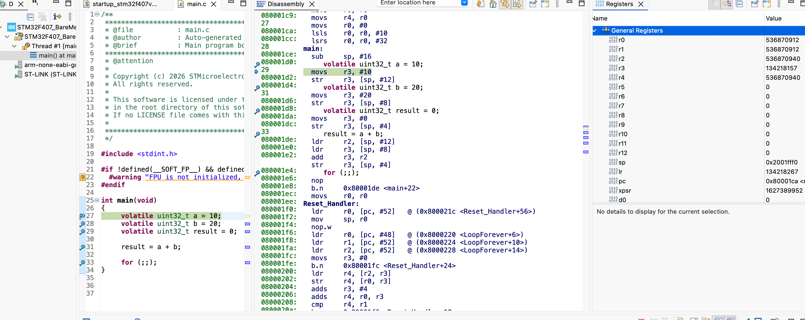
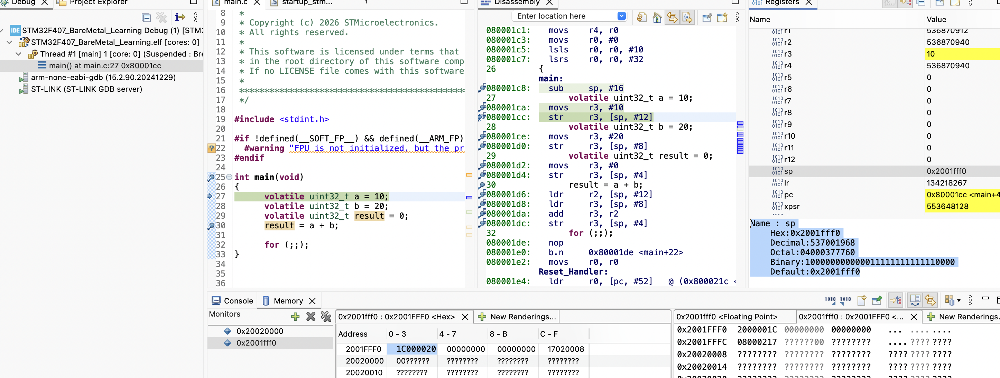
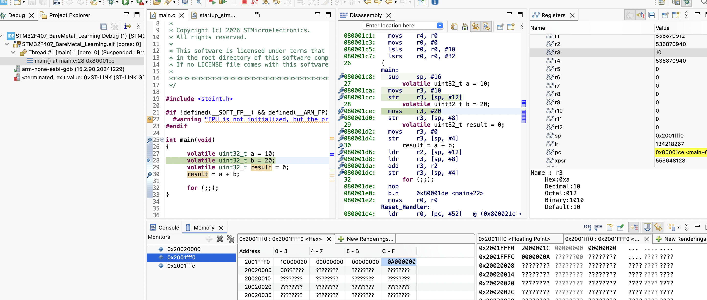

# CPU Architecture - Inside the Cortex-M4

Target is the ARM Cortex-M4 inside STM32F407VG.

For now, let's focus on four important parts:
- Registers: Very small, very fast storage locations inside the processor.
- ALU (Arithmetic Logic Unit): Performs arithmetic and logical operations.
- Control unit: Coordinates instruction execution.
- Bus interface: Allows the processor to communicate with memory and other parts of the system.
The Cortex-M4 also has additional components, such as its instruction pipeline and optional floating-point unit. We'll explore those later.

Let me start with a basic code to add two numbers: 
```c
int main(void)
{
    volatile uint32_t a = 10;
    volatile uint32_t b = 20;
    volatile uint32_t result = 0;
    result = a + b;
}
```
**Without volatile, the compiler may assume the value cannot change spontaneously and may remove necessary reads or writes. With keyword volatile, the compiler must not optimise and must read and write each time from memory**

I would like to investigate:
1. Where does the value 10 go?
2. Where does the value 20 go?
3. Which CPU component performs the addition?
4. Where does the result 30 go?
5. How does the CPU know what to execute next?

Eventually, the compiler generates machine instructions that the processor can execute. For illustration, the assembly might look like,

```asm
MOVS R0, #10  
MOVS R1, #20
ADDS R2, R0, R1
```

MOVS R0, #10   : This instruction tells the processor to put the value 10 into register R0. Conceptually, Register R0 inside the processor has Value 10 stored.  The value is now available inside the CPU for further operations. Placed the 1st value in one of the resgiter which is R0.

- MOV means move a value.
- S means update the condition flags in the processor's status register (xPSR).
- R0 is the destination register.
- #10 means the immediate value 10, provided directly in the instruction.

**Difference: MOV vs MOVS**

```asm
MOV  R0, #10
MOVS R0, #10
```
Both put the value 10 into R0. The difference is,
- MOV updates R0 but does not update the condition flags in APSR. 
- MOVS updates R0 and updates certain condition flags (N, Z) in the APSR. These flags help the processor make decisions, such as whether to execute a conditional branch like BEQ. 

APSR = Application Program Status Register. It is part of the processor's combined program status register (xPSR).
APSR condition flags : (N: Negative, Z : Zero, C : Carry, V : Overflow)

**What happens when we execute MOVS R0, #10?**
After execution:
- R0 = 10
- N = 0, because 10 is positive.
- Z = 0, because 10 is not zero.
- C = unchanged.
- V = unchanged.

C and V unchanged because this particular MOVS immediate instruction updates N and Z, but does not calculate a carry or signed arithmetic overflow. The S suffix does not mean that every flag is updated by every instruction.

Similarly, ```asm MOVS R1, #20``` will update R0 with value 20 and update N, Z flags in APSR. 

```asm ADDS R2, R0, R1 ``` 

This instruction tells the processor to, 
1. Take the value from R0.
2. Take the value from R1.
3. Add the two values using the ALU.
4. Store the result in R2.
5. Update the applicable condition flags.

The resulting flags are:

|Flag	| Value	| Reason |
|-------|-------|--------|
|N	    |  0	| Result is positive |
|Z	    |  0	| Result is not zero |
|C	    |  0	| No unsigned carry |
|V	    |  0	| No signed overflow |


Connecting this to C :
```c
uint32_t a = 10;
uint32_t b = 20;
uint32_t result = a + b;
```

Conceptually, the compiler translates the addition into instructions that perform the same operation. The compiler may choose different registers or instructions depending on optimization and compiler settings.
The ALU performs the arithmetic, CPU registers hold the operands and result, and the condition flags record information about the result.

### Lets inspect this operation to the actual CPU register values in STM32 debugger:

-   1.  Set a breakpoint at sub sp, #16.
-   2.  Start debugging.
-   3.  Open Registers and find SP (or MSP). 
-   4.  Execute one instruction using Step Into (F5).
-   5.  Check SP again.
-   6. When execution stops there, inspect these registers (PC, SP, R3, R2)

### Disassembly in Text form :

```asm
080001c8:   sub     sp, #16
27        	  volatile uint32_t a = 10;
080001ca:   movs    r3, #10
080001cc:   str     r3, [sp, #12]
28        	  volatile uint32_t b = 20;
080001ce:   movs    r3, #20
080001d0:   str     r3, [sp, #8]
29        	  volatile uint32_t result = 0;
080001d2:   movs    r3, #0
080001d4:   str     r3, [sp, #4]
31        	  result = a + b;
080001d6:   ldr     r2, [sp, #12]
080001d8:   ldr     r3, [sp, #8]
080001da:   add     r3, r2
080001dc:   str     r3, [sp, #4]
33        	  for (;;);
080001de:   nop     
080001e0:   b.n     0x80001de <main+22>
080001e2:   movs    r0, r0
```



### 1. Allocating stack memory:

### Observation :
### Before executing sub sp, #16

|Register Value|
|----------------|
|PC	: 0x080001C8|
|SP	: 0x20020000|
|R2	: 0x2000001C|
|R3	: 0x080001AD|

Notice that R2 and R3 contain old values from earlier execution. That's fine. Registers are not automatically cleared when main() starts.

### Observation : 
### After executing sub sp, #16 :**

|Register : New Value| Old value |
|----------------| --------------|
|PC	0x080001CA| 0x080001C8|
|SP	0x2001FFF0| 0x20020000|

Our stack frame is now allocated. Lets track R2 and R3 when instructions use them. 

```asm 080001c8: sub sp, #16``` :  The processor decreases SP by 16 bytes as the compiler reserves 16 bytes of stack space. Why 16 bytes when we have only three variables, each 4 bytes? Each uint32_t occupies 4 bytes:
- a = 4 bytes
- b = 4 bytes
- result = 4 bytes

Total = 12 bytes. 

The compiler reserves 16 bytes, leaving an additional 4 bytes of space. Why does GCC reserve 4 extra bytes for alignment?

First, what is stack alignment?

The Cortex-M4 uses a stack that is normally required to be 8-byte aligned at public function boundaries, according to the ARM procedure call standard (AAPCS).

What does 8-byte aligned mean? It means the stack pointer should have an address divisible by 8. For example,
```text
0x20020000  -> divisible by 8 
0x2001FFF8  -> divisible by 8 
0x2001FFF0  -> divisible by 8 
```
Initially, SP = 0x20020000 (8 byte aligned) and these 3 variables need 12 bytes. If GCC reserved only 12 bytes, 0x20020000 - 12 = 0x2001FFF4. But 0x2001FFF4 is not divisible by 8. Therefore, the stack would no longer be 8-byte aligned. 

Hence GCC reserves 16 bytes, 0x20020000 - 16 = 0x2001FFF0. Now SP is still 8-byte aligned. That's the actual reason for the extra 4 bytes in this case. The compiler is not wasting 4 bytes because the Cortex-M4 needs 16-byte memory access. It is maintaining the required stack alignment. And alignment matters because function calls and certain data accesses rely on the ABI's alignment rules.

The stack grows towards lower memory addresses. SP points to the current top of the stack. It does not point to R3 or any CPU register. So So initially, the MSP was 0x20020000. 16 bytes should be decremented from 0x20020000, which is 0x2001FFF0. 

But my processor M4 Cortex is 32 bits which is 4 bytes. Then why should it be 8 bytes aligned. And thats connecting the processor's architecture with its memory requirements. The key distinction is 32-bit processor does not mean 4-byte stack alignment.

These are two different concepts.
- 32-bit: Cortex-M4 general-purpose registers are 32 bits wide. A normal register can hold 4 bytes.
- 8-byte stack alignment: A rule defined by the ARM procedure call standard (AAPCS), which governs how functions use the stack and exchange data.

Why does ARM require 8-byte alignment?
One important reason is that the processor supports 64-bit data types and operations, including floating-point operations through its FPU. A 64-bit value occupies 8 bytes. Keeping the stack 8-byte aligned helps ensure that data requiring 8-byte alignment is properly positioned. Also, this is an ABI convention, not a hardware restriction saying the CPU cannot operate with a stack aligned to 4 bytes.

How do I know the alignment rule for another microcontroller?
Need to check its ABI / calling convention, not just its processor bit width.

For example:
Architecture / ABI	- Typical stack alignment at function interfaces
ARM Cortex-M (AAPCS)	- 8 bytes
x86-64 System V - 	16 bytes
RISC-V standard ABI -	16 bytes

These are ABI requirements, not universal rules for all processors of those architectures.

The important distinction is that there are two layers:
1. Hardware architecture: What the processor can do.
2. ABI: Rules that compilers and functions must follow when using that processor.

Hence, when working with a new microcontroller, look for its ABI documentation and the compiler's target configuration.

For STM32F407, the relevant document is ARM's AAPCS32.

So, here in my case code, GCC rounds the 12-byte local-variable area up to 16 bytes to preserve the 8-byte stack alignment.

|Stage	| SP value |
|-------|----------|
|Before sub sp, #16	| 0x20020000 |
|After sub sp, #16 |	0x2001FFF0|

### 080001ca:   movs    r3, #10

Let me trace that in debugger where the three variables occupy 12 bytes within those 16 bytes.
In debugging session, inspecting PC , R3, SP by executing the next instruction which is ```asm movs r3, #10``` by pressing F5(step into) once.



|Register	: Current value |
|---------------------------|
|R3	: 0x0000000A (10) |
|PC	: 0x080001CC |
|SP	: 0x2001FFF0 |

- R3 now holds 10.
- SP hasn't changed.
- PC has advanced to the next instruction.0x080001CC


### Store 10 in stack memory : 0x080001CC: str r3, [sp, #12]



- PC become 0x080001CE.
- SP remain 0x2001FFF0.
- R3 remain 10. 

Let's interpret  Memory view.

```text
Address     0 - 3     4 - 7     8 - B     C - F
2001FFF0    1C000020  00000000  00000000  0A000000
```
The last group, C - F, represents addresses:
```text
0x2001FFFC
0x2001FFFD
0x2001FFFE
0x2001FFFF
```

And 0A000000 represents the bytes 0A 00 00 00 in little-endian order.

So we have confirmed:
- R3 contains 10.
- STR copied those 4 bytes into RAM.
- SP did not change.
- PC advanced to the next instruction.

```asm
080001c8:   sub     sp, #16
27        	  volatile uint32_t a = 10;
080001ca:   movs    r3, #10
080001cc:   str     r3, [sp, #12]
28        	  volatile uint32_t b = 20;
080001ce:   movs    r3, #20
080001d0:   str     r3, [sp, #8]
29        	  volatile uint32_t result = 0;
080001d2:   movs    r3, #0
080001d4:   str     r3, [sp, #4]
31        	  result = a + b;
080001d6:   ldr     r2, [sp, #12]
080001d8:   ldr     r3, [sp, #8]
080001da:   add     r3, r2
080001dc:   str     r3, [sp, #4]
33        	  for (;;);
080001de:   nop     
080001e0:   b.n     0x80001de <main+22>
080001e2:   movs    r0, r0
```

### Assembly execution map:

|Address	|Instruction	|What we'll observe |
|---------|-----------------|-------------------|
|0x080001C8	|sub sp, #16	|Stack allocation|
|0x080001CA	|movs r3, #10	|R3 receives 10|
|0x080001CC	|str r3, [sp, #12]	|Store a in RAM|
|0x080001CE	|movs r3, #20	|R3 receives 20|
|0x080001D0	|str r3, [sp, #8]	|Store b in RAM|
|0x080001D2	|movs r3, #0	|R3 receives 0|
|0x080001D4	|str r3, [sp, #4] |	Store result in RAM|
|0x080001D6	|ldr r2, [sp, #12] |	Load a into R2|
|0x080001D8	|ldr r3, [sp, #8]	|Load b into R3|
|0x080001DA	|add r3, r2	| Addition|
|0x080001DC	|str r3, [sp, #4]	|Store result in RAM|