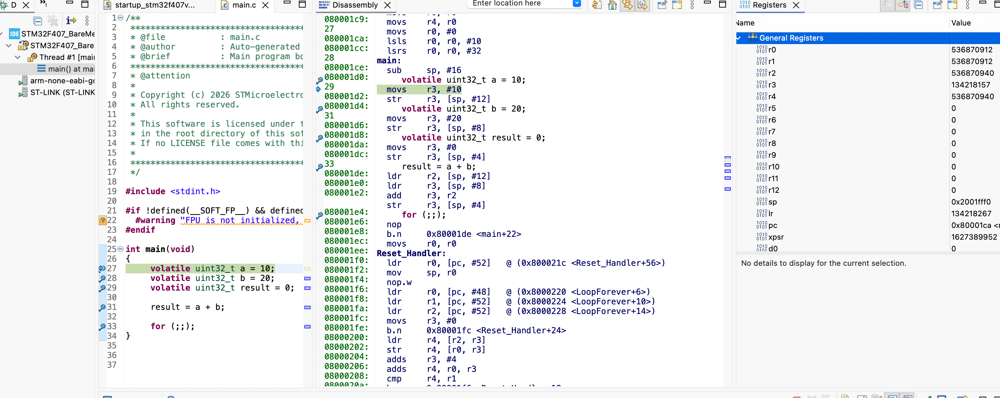
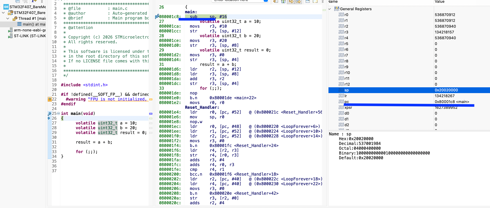
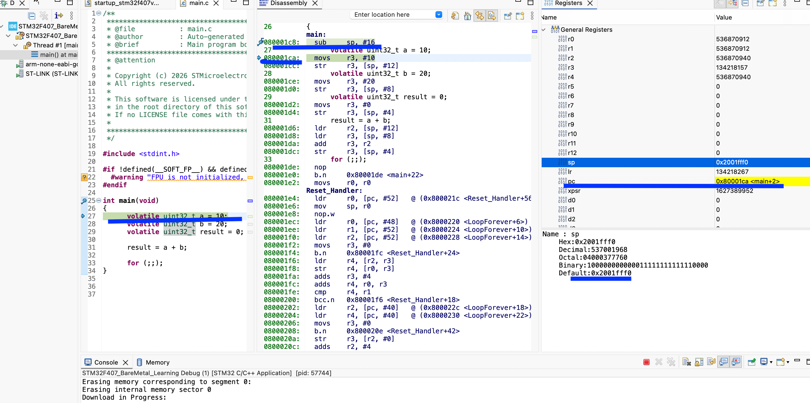
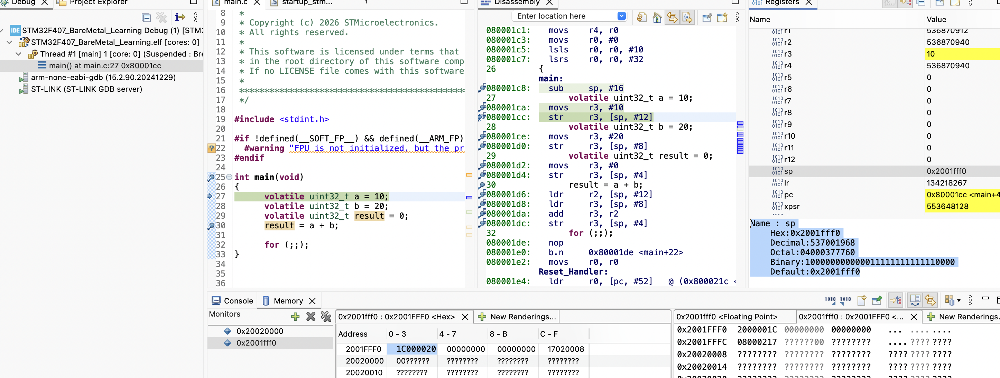

# CPU Architecture - Inside the Cortex-M4

Target is the ARM Cortex-M4 inside my STM32F407VG.

For now, let's focus on four important parts:
- Registers: Very small, very fast storage locations inside the processor.
- ALU (Arithmetic Logic Unit): Performs arithmetic and logical operations.
- Control unit: Coordinates instruction execution.
- Bus interface: Allows the processor to communicate with memory and other parts of the system.
The Cortex-M4 also has additional components, such as its instruction pipeline and optional floating-point unit. We'll explore those later.

Let me start with a basic code to add two numbers: 
```c
#include <stdint.h>

int main(void)
{
    volatile uint32_t a = 10;
    volatile uint32_t b = 20;
    volatile uint32_t result = 0;
    result = a + b;
}
```
**`volatile` tells the compiler that each access to these objects matters. The compiler must preserve those reads and writes, but `volatile` does not turn off every optimization. In this build, the volatile values are stored in the stack frame and read back before the addition.**

I would like to investigate:
1. Where does the value 10 go?
2. Where does the value 20 go?
3. Which CPU component performs the addition?
4. Where does the result 30 go?
5. How does the CPU know what to execute next?

Eventually, the compiler generates machine instructions that the processor can execute. For a simple illustration, if the two values are already in registers, the assembly might look like this:

```asm
MOVS R0, #10  
MOVS R1, #20
ADDS R2, R0, R1
```

MOVS R0, #10   : This instruction tells the processor to put the value 10 into register R0. The value is now available inside the CPU for further operations. The first value, 10, is in register R0.

- MOV means move a value.
- S means update the condition flags in the processor's status register (xPSR).
- R0 is the destination register.
- #10 means the immediate value 10, provided directly in the instruction.

**Difference: MOV vs MOVS**

```asm
MOV  R0, #10
MOVS R0, #10
```
Both put the value 10 into R0. The difference is,
- MOV updates R0 but does not update the condition flags in APSR. 
- MOVS updates R0 and updates certain condition flags (N, Z) in the APSR. These flags help the processor make decisions, such as whether to execute a conditional branch like BEQ. 

APSR = Application Program Status Register. It is part of the processor's combined program status register (xPSR).
APSR condition flags : (N: Negative, Z : Zero, C : Carry, V : Overflow)

**What happens when we execute MOVS R0, #10?**
After execution:
- R0 = 10
- N = 0, because 10 is positive.
- Z = 0, because 10 is not zero.
- C = unchanged.
- V = unchanged.

C and V unchanged because this particular MOVS immediate instruction updates N and Z, but does not calculate a carry or signed arithmetic overflow. The S suffix does not mean that every flag is updated by every instruction.

Similarly, ```asm MOVS R1, #20``` puts 20 into R1 and updates the N and Z flags in APSR. 

```asm ADDS R2, R0, R1 ``` 

This instruction tells the processor to, 
1. Take the value from R0.
2. Take the value from R1.
3. Add the two values using the ALU.
4. Store the result in R2.
5. Update the applicable condition flags.

The resulting flags are:

|Flag	| Value	| Reason |
|-------|-------|--------|
|N	    |  0	| Result is positive |
|Z	    |  0	| Result is not zero |
|C	    |  0	| No unsigned carry |
|V	    |  0	| No signed overflow |


Connecting this to C :
```c
uint32_t a = 10;
uint32_t b = 20;
uint32_t result = a + b;
```

Conceptually, the compiler translates the addition into instructions that perform the same operation. The compiler may choose different registers or instructions depending on optimization and compiler settings.
The ALU performs the arithmetic, CPU registers hold the operands and result, and the condition flags record information about the result.

Let's inspect this operation and the actual CPU register values in the STM32 debugger. The disassembly is shown here in text form:

```asm
080001c8:   sub     sp, #16
27        	  volatile uint32_t a = 10;
080001ca:   movs    r3, #10
080001cc:   str     r3, [sp, #12]
28        	  volatile uint32_t b = 20;
080001ce:   movs    r3, #20
080001d0:   str     r3, [sp, #8]
29        	  volatile uint32_t result = 0;
080001d2:   movs    r3, #0
080001d4:   str     r3, [sp, #4]
31        	  result = a + b;
080001d6:   ldr     r2, [sp, #12]
080001d8:   ldr     r3, [sp, #8]
080001da:   add     r3, r2
080001dc:   str     r3, [sp, #4]
33        	  for (;;);
080001de:   nop     
080001e0:   b.n     0x80001de <main+22>
080001e2:   movs    r0, r0
```





**1. Allocating stack memory:**
```asm 080001c8: sub sp, #16 ``` The processor decreases SP by 16 bytes as the compiler reserves 16 bytes of stack space. Why 16 bytes when we have only three variables, each 4 bytes? Each uint32_t occupies 4 bytes:
- a = 4 bytes
- b = 4 bytes
- result = 4 bytes
Total = 12 bytes. 

The compiler reserves 16 bytes, leaving an additional 4 bytes of space. Why does GCC reserve 4 extra bytes for alignment?

First, what is stack alignment?

The Cortex-M4 uses a stack that is normally required to be 8-byte aligned at public function boundaries, according to the ARM procedure call standard (AAPCS).

What does 8-byte aligned mean? It means the stack pointer should have an address divisible by 8. For example,
```text
0x20020000  -> divisible by 8 
0x2001FFF8  -> divisible by 8 
0x2001FFF0  -> divisible by 8 
```
Initially, SP = 0x20020000 (8 byte aligned) and these 3 variables need 12 bytes. If GCC reserved only 12 bytes, 0x20020000 - 12 = 0x2001FFF4. But 0x2001FFF4 is not divisible by 8. Therefore, the stack would no longer be 8-byte aligned. Hence GCC reserves 16 bytes, 0x20020000 - 16 = 0x2001FFF0. Now SP is still 8-byte aligned. That's the actual reason for the extra 4 bytes in this case
The compiler is not reserving 4 extra bytes because the Cortex-M4 needs 16-byte memory access. In this example, GCC rounds the stack allocation up to 16 bytes so that SP remains 8-byte aligned. This follows the ABI's stack-alignment rule.

The stack grows towards lower memory addresses. SP points to the current top of the stack. It does not point to R3 or any CPU register. Initially, MSP was 0x20020000. The `SUB` instruction decreases it by 16 bytes. Let's trace that in the debugger.
 
But my processor M4 Cortex is 32 bits which is 4 bytes. Then why should it be 8 bytes aligned. And thats connecting the processor's architecture with its memory requirements. The key distinction is 32-bit processor does not mean 4-byte stack alignment.

These are two different concepts.
- 32-bit: Cortex-M4 general-purpose registers are 32 bits wide. A normal register can hold 4 bytes.
- 8-byte stack alignment: A rule defined by the ARM procedure call standard (AAPCS), which governs how functions use the stack and exchange data.

Why does ARM require 8-byte alignment?
For this program, the important point is that AAPCS32 defines the alignment rule at public function interfaces. It is an ABI convention that lets separately compiled functions follow the same stack rules. It is not a hardware restriction saying the CPU cannot operate with a stack aligned to 4 bytes, and it does not mean every 64-bit value must be stored on the stack.

How do I know the alignment rule for another microcontroller?
Need check its ABI / calling convention, not just its processor bit width.

For example:
Architecture / ABI	- Typical stack alignment at function interfaces
ARM Cortex-M (AAPCS)	- 8 bytes
x86-64 System V - 	16 bytes
RISC-V standard ABI -	16 bytes

These are ABI requirements, not universal rules for all processors of those architectures.
The important distinction
There are two layers:
1. Hardware architecture: What the processor can do.
2. ABI: Rules that compilers and functions must follow when using that processor.
When working with a new microcontroller, look for its ABI documentation and the compiler's target configuration.

For STM32F407, the relevant document is ARM's AAPCS32.

So, here in my case code, GCC rounds the 12-byte local-variable area up to 16 bytes to preserve the 8-byte stack alignment.

|Stage	| SP value |
|-------|----------|
|Before sub sp, #16	| 0x20020000 |
|After sub sp, #16 |	0x2001FFF0|

The three variables occupy 12 bytes within those 16 bytes.
Let's verify it in the debugger:
-   1.  Set a breakpoint at sub sp, #16.
-   2.  Start debugging.
-   3.  Open Registers and find SP (or MSP).
-   4.  Execute one instruction using Step Into (F5).
-   5.  Check SP again.



**SP value after executing the next instruction:**



**Observation:**

- Before sub sp, #16: 0x20020000
- After sub sp, #16: 0x2001FFF0

Let's calculate the difference, 0x20020000 - 0x2001FFF0 = 0x10 = 16 bytes. So the CPU has moved the Stack Pointer down by 16 bytes.
The stack is in RAM, and SP holds the address of the current top of the stack. The SUB instruction changes SP and it doesn't itself write the three variables into RAM.

After executing ```asm movs r3, #10```, R3 contains 10. This instruction loads an immediate value into the register; it does not access the stack in RAM. SP remains 0x2001FFF0. The screenshot shows the debugger stopped at the following instruction, `movs r3, #20`.
 


## Storing the values in RAM

The next instruction is:

```asm
str r3, [sp, #12]
```

`STR` means **Store Register**. It takes the value in R3 and writes it to a memory address. The address is calculated from the current SP plus the offset:

```text
SP       = 0x2001FFF0
SP + 12  = 0x2001FFFC
R3       = 10
```

So this instruction writes the 32-bit value 10 to address `0x2001FFFC`. In this example, that is where GCC placed `a`. `STR` does not change SP.

The next two instructions are:

```asm
movs r3, #20
str  r3, [sp, #8]
```

`MOVS` puts 20 into R3. Then `STR` writes the value in R3 to `SP + 8`, which is `0x2001FFF8`. This is where GCC placed `b`.

Next, GCC initializes `result` to 0:

```asm
movs r3, #0
str  r3, [sp, #4]
```

R3 becomes 0, and `STR` writes that value to `SP + 4`, or `0x2001FFF4`. This is where GCC placed `result`. Later, the calculated sum will be written to this same address.

At this point, the stack frame looks like this:

| Stack address | Value | Variable |
|---------------|-------|----------|
| `0x2001FFFC` (`SP + 12`) | 10 | `a` |
| `0x2001FFF8` (`SP + 8`) | 20 | `b` |
| `0x2001FFF4` (`SP + 4`) | 0 | `result` |
| `0x2001FFF0` (`SP + 0`) | unused padding | alignment |

The 4 bytes at `SP + 0` are the extra space in this 16-byte allocation. GCC uses the other 12 bytes for the three `uint32_t` variables.

## Loading the values into registers

Before adding `a` and `b`, the processor has to load their values from RAM into registers. These are the next instructions:

```asm
ldr r2, [sp, #12]
ldr r3, [sp, #8]
```

`LDR` means **Load Register**. It reads a value from a memory address and puts it into a CPU register.

The first instruction reads from `SP + 12`, where `a` was stored:

```text
Address 0x2001FFFC contains 10
R2 = 10
```

The second instruction reads from `SP + 8`, where `b` was stored:

```text
Address 0x2001FFF8 contains 20
R3 = 20
```

The values are now in registers for the addition. `LDR` does not change SP or overwrite the values in RAM.

## Adding the two values

The next instruction is:

```asm
add r3, r2
```

In this two-register form, R3 is both the destination and one of the inputs. The processor adds the current value of R2 to the current value of R3, then stores the answer in R3:

```text
R3 = R3 + R2
R3 = 20 + 10
R3 = 30
```

The ALU performs the addition. R2 still contains 10, and R3 now contains 30. The assembly shown here is from this compiler build; another build may choose different registers or a different instruction sequence for the same C expression.

The final instruction for the assignment is:

```asm
str r3, [sp, #4]
```

It writes 30 from R3 to `SP + 4`, the stack location for `result`. The value in RAM at `0x2001FFF4` is now 30.

This is how the values move during this example:

```text
RAM: a = 10 ── LDR ──> R2 = 10 ──┐
                                 ├── ADD ──> R3 = 30 ── STR ──> RAM: result = 30
RAM: b = 20 ── LDR ──> R3 = 20 ──┘
```

The compiler first stores the volatile variables in the stack frame. It then loads `a` and `b` into registers, adds them, and stores the result back to RAM. The exact register choices and stack offsets come from this build; C does not specify them.

## Repeating the infinite loop

After the result is stored, the disassembly shows:

```asm
080001de: nop
080001e0: b.n 0x80001de <main+22>
```

`NOP` means **No Operation**. It does not change the general-purpose registers or SP. The processor still moves on to the next instruction, so the PC advances.

`B` means **Branch**. This `B.N` is a short Thumb branch. Its destination is `0x80001DE`, the address of the `NOP` instruction. The processor executes the `NOP`, reaches the branch, and jumps back to the `NOP` again. This repeats forever, matching the C code `for (;;);`.

The listing also shows a `movs r0, r0` immediately after the branch. It copies the value in R0 back into R0, so the register value stays the same; like other `MOVS` instructions, it updates the applicable condition flags. The branch keeps execution inside the loop, so this instruction is not reached by this program. In this disassembly it appears as padding before the next code section; it is not part of the loop's work.

## What I observed

1. `SUB SP, #16` reserves 16 bytes in the stack frame.
2. `MOVS` puts immediate values into R3.
3. `STR` writes the values from R3 into the stack locations for `a`, `b`, and `result`.
4. `LDR` reads `a` and `b` from RAM into R2 and R3.
5. `ADD` uses the ALU to calculate 30 and leaves the answer in R3.
6. `STR` writes 30 back to the stack location for `result`.
7. `NOP` and `B.N` repeat forever, as requested by `for (;;);`.

The CPU does not understand the C variable names `a`, `b`, and `result`. The compiler chose stack addresses and registers for them. The instructions tell the processor exactly when to move values between RAM and registers and when to perform the addition.

