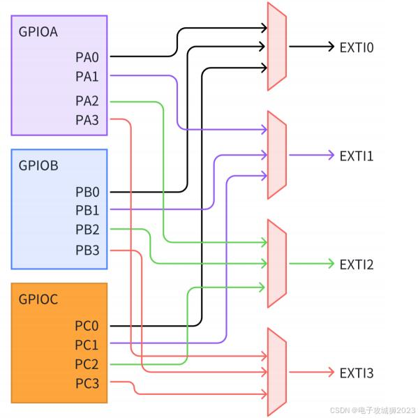

## Interrupts and NVIC
Date: 08. Nov. 206

### Why do we need Interrupts?
Imagine STM32 is executing a continious loop in main() and suddenly someone presses a button connected to the STM32. How do the STM32 know that the button was pressed?

```c
while (1)
{
    // Main program keeps running
}
```
There are two possible approaches,
1.  The CPU repeatedly checks the button's state. (Called as Polling)
2.  The hardware notifies the CPU when the button is pressed.(Called as Interrupt)

### 1. Polling:
The CPU repeatedly checks whether the button has been pressed. The CPU keeps checking, even when nobody presses the button.
while (1)
{
    if (button_pressed())
    {
        // Do something
    }
}

### 2. Interrupt:
The hardware signals the CPU when the button is pressed. The CPU can then respond to that event.

**The important difference:**
- Polling: CPU asks, "Has the button been pressed?"
- Interrupt: Hardware tells the CPU, "The button has been pressed!"

**Example:**
In the interrupt approach, imagine the CPU is currently executing the below code and suddenly the button is pressed.
```c
while (1)
{
    counter++;
}
```
An interrupt's priority determines whether it can interrupt the code currently executing  or whether it must wait.

For example:
- If the interrupt is enabled and has sufficient priority then the CPU can interrupt the main code.
- If another higher-priority interrupt is executing then a lower-priority interrupt must wait.
- If interrupts are disabled or the interrupt is masked then it cannot be handled immediately. 

If the interrupt is enabled and has sufficient priority then the CPU doesn't necessarily wait for the current while loop to finish. It can interrupt the main program between instructions, save the necessary processor state, and start executing the interrupt handler.

For example, if the CPU is executing ```c counter++; ``` a button interrupt arrives, does the CPU need to wait until the entire while(1) loop finishes? 

The CPU does not wait for the entire while(1) loop to finish.

If the interrupt is eligible to be handled, the Cortex-M4:
1. Finishes the instruction currently executing.
2. Automatically saves certain processor registers onto the stack.
3. Starts executing the corresponding Interrupt Service Routine (ISR).

The CPU generally completes the current instruction, not necessarily the entire C statement. A single C statement such as counter++ can generate multiple assembly instructions. 

### CPU saving registers before executing the ISR: 
Why should the CPU need to save the registers before executing the ISR? The CPU needs to preserve the main program's state so it can resume correctly after the interrupt handler finishes. When an interrupt occurs, the Cortex-M4 automatically saves these registers onto the currently active stack:
-   R0
-   R1
-   R2
-   R3
-   R12
-   LR / R14
-   PC / R15
-   xPSR

This is called as **exception stacking**. The saved PC is particularly important because it helps the CPU know where to resume the interrupted program. The CPU uses whichever stack was active before the exception:
- Thread mode using MSP -> saves on MSP.
- Thread mode using PSP -> saves on PSP.

When entering Handler mode, the CPU uses MSP by default.

Example : If main program is running in Thread mode using PSP and an interrupt occurs, which stack receives the automatically saved registers? PSP receives the automatically saved registers (R0-R3, R12, LR, PC, xPSR). Because the interrupted program was running in Thread mode using PSP. Even though the CPU switches to MSP when entering Handler mode, the original register context is stacked on PSP.

1.  Main program was running in Thread mode using PSP.
2.  CPU saved the interrupted context onto PSP.
3.  CPU switched to Handler mode using MSP.
Now the ISR completes.

Now after understanding what happens upon Cortex-M4 exception entry, its time to understand what happens when the ISR finishes and how the CPU returns to the interrupted program.  How does the CPU know that it must return to the interrupted program and restore its saved registers? Its with the help of special value stored in LR (Link Register) called **EXC_RETURN.**

When the Cortex-M4 enters an exception handler, LR receives a special EXC_RETURN value. When the handler executes ```asm BX LR``` the processor recognises that special value and performs exception return, restoring the saved context.

### LR / R14 during an interrupt vs normal function calls:
#### Normal function call:
For example:
```c
main()
{
    function_A();
}
```
When function_A() is called, LR receives the return address ie where execution should continue after function_A() finishes.
#### Interrupt / exception entry
When an interrupt occurs, the Cortex-M4 places a special value called EXC_RETURN in LR. This value tells the processor how to return from the exception, including information about,

- Return to Thread mode or Handler mode.
- Use MSP or PSP for the restored context.

EXC_RETURN is not the address of the interrupted instruction. The interrupted PC is saved separately in the automatically stacked exception frame.

Lets consider an example: Suppose the CPU is executing main() and an interrupt occurs. Where is the return location of the interrupted main program saved? PC in the exception stack frame. 

### Quick Overview:
When an interrupt occurs,

1. The CPU automatically saves R0–R3, R12, LR, PC and xPSR onto the active stack.
2. LR receives the special EXC_RETURN value.
3. The CPU enters Handler mode and executes the ISR.
4. When the ISR executes BX LR, the processor recognises EXC_RETURN.
5. The CPU restores the saved registers and resumes the interrupted program

Two different purposes:

- Stacked PC -> remembers where the interrupted program should resume.
- LR (EXC_RETURN) -> tells the processor how to perform exception return.

### NVIC : Nested Vectored Interrupt Controller
NVIC is a hardware block inside the Cortex-M4 processor/core system that manages interrupts from peripherals and other external sources. The NVIC's job is basically to help the processor manage interrupt requests. NVIC is the hardware interrupt controller that manages interrupts.

It manages interrupts, including enabling, disabling and prioritising them. For example, the GPIO peripheral(s)) itself cannot decide interrupt priority, **NVIC** handles interrupt priorities in the Cortex-M4. Whereas the GPIO peripheral detects the button event, but it doesn't decide the CPU's interrupt priority.
```text
                    GPIO peripheral
Detects the button press and generates an interrupt request.
                            │
                            │
                            v
        NVIC (Nested Vectored Interrupt Controller)
Manages interrupt enabling, pending status and priorities.
                            │
                            │
                            v
                      Cortex-M4 CPU
Accepts an eligible interrupt and executes its ISR.
```
### Priorioties Order:
On Cortex-M4, a smaller numerical priority value means higher priority.

-   Priority 0 = highest configurable priority.
-   Priority 1 = next highest.
-   Priority 5 = lower than priority 2.
-   Larger numerical value = lower priority.

The Cortex-M4 also has fixed-priority exceptions, parked for furture learning. 

Suppose if two interrupts arrive, 
Interrupt A with Priority 2 and
Interrupt B with Priority 5,
The Rule is a smaller numerical priority value means higher priority. So Interrupt A with Priority 2 will be servered. 

What happens when a higher-priority interrupt arrives when CPU currently serving an interrupt?
Imagine, 
1. Interrupt B (priority 5) is currently executing.
2. Interrupt A (priority 2) arrives.

Here, The CPU pauses Interrupt B and execute Interrupt A first. This is called **Nested Interrupts or Interrupt Preemption.**
```text
Main program
     |
     v
Interrupt B (Priority 5) starts
     |
     v
Interrupt A (Priority 2) arrives
     |
     v
CPU pauses Interrupt B
     |
     v
Interrupt A (Priority 2) executes
     |
     v
Interrupt A finishes
     |
     v
CPU resumes Interrupt B
     |
     v
Interrupt B finishes
     |
     v
Main program resumes
```
Interrupt A has a higher priority, so it can preempt Interrupt B. The CPU automatically preserves the context needed to resume Interrupt B, just as it did when entering the first interrupt.

Suppose Interrupt B (priority 5) is executing, and another Interrupt C (priority 7) arrives. Interrupt C (priority 7) has a lower priority than Interrupt B (priority 5). Therefore, it cannot preempt B. It becomes pending and waits until the CPU can service it.

**Active:** The CPU is currently executing the ISR.
**Pending:** The interrupt has occurred but is waiting to be serviced.
**Preemption:** A higher-priority interrupt interrupts a lower-priority ISR.

The NVIC maintains interrupt states such as pending and active. It decides which eligible interrupt can be presented to the CPU.

### Enabling an interrupt in NVIC:
The register NVIC_ISER : ISER stands for Interrupt Set-Enable Register. The NVIC provides registers that allow us to enable individual interrupts. For example, suppose we want to enable an external interrupt generated by GPIO pin input through EXTI line 0. The corresponding interrupt is called EXTI0_IRQn in the STM32 software libraries.

STM32F407 uses multiple NVIC enable registers, not just one. Because the NVIC supports many interrupt sources, and each ISER register contains 32 enable bits.

For example:
```text
Register	Interrupts covered
NVIC_ISER0	IRQ 0–31
NVIC_ISER1	IRQ 32–63
NVIC_ISER2	IRQ 64–95
NVIC_ISER3	IRQ 96–127
NVIC_ISER4	IRQ 128–159
NVIC_ISER5	IRQ 160–191
NVIC_ISER6	IRQ 192–223
NVIC_ISER7	IRQ 224–255
```

Each bit controls one external interrupt.

Suppose EXTI0 has IRQ number 6 on STM32F407. It belongs to NVIC_ISER0. It uses bit 6. So enabling EXTI0 means setting bit 6 in NVIC_ISER0. Conceptually, NVIC_ISER0 |= (1U << 6); This is only a conceptual register operation for now; will verify the actual register address and behaviour before writing hardware code.

### What is EXTI line 0 :
Earlier example where we want the STM32F407 to detect when someone presses a button. Imagine we connect a button to PA0 (GPIO Port A, Pin 0). The STM32 MCU has a hardware peripheral called EXTI — External Interrupt/Event Controller. Its job is to detect selected changes on GPIO pins and generate interrupt requests.

- PA0 = physical GPIO pin 0 on Port A.
- EXTI0 = interrupt line number 0 inside the EXTI peripheral.



When PA0 is configured as the source for EXTI line 0, a selected signal change on PA0 can trigger EXTI0. PA0 and EXTI0 are not the same thing. PA0 is a physical pin; EXTI0 is an internal interrupt line.

-    **PA0:** Physical pin where the button is connected.
-    **EXTI0:** Internal EXTI line that monitors the selected signal from PA0.(EXTI lines are numbered by the pin number, not the GPIO port.)
-    **NVIC:** Manages the interrupt request and its priority.

```text
Button press
      │
      v
PA0 (GPIO pin)
      │
      v
EXTI line 0
      │
      v
NVIC
      │
      v
Cortex-M4 CPU
      │
      v
EXTI0_IRQHandler()
```
PA0 must be selected as the source for EXTI line 0 through the SYSCFG configuration (Future learning!)

If we connect the button to PB0 instead of PA0, which EXTI line would we use? EXTI lines are numbered by the pin number, not the GPIO port. PB0 also uses EXTI0.

|GPIO pin	|EXTI line xf
|----------|---------|
|PA0	|EXTI0|
|PB0	|EXTI0|
|PC0	|EXTI0|
|PA1	|EXTI1|
|PB1	|EXTI1|
|PC1	|EXTI1|

If we connect a button to PC5, we would we configure EXTI5 line. 

**Important STM32F407 limitation: For a given EXTI line, we can select only one GPIO port as its source at a time. For example, EXTI0 can monitor PA0 or PB0 or PC0, but not all three simultaneously.**

**EXTI does not have 32 lines because GPIO ports have 32 pins or so. On the STM32F407, EXTI has 23 lines: EXTI0 to EXTI22.**
They are divided into two categories:
|EXTI lines | Source |
|------------|---------|
|EXTI0–EXTI15	| GPIO pins |
|EXTI16–EXTI22	| Internal MCU sources |

For example, some internal sources include PVD, RTC and USB wakeup events. GPIO ports have a maximum of 16 pins each, numbered 0–15, not 32 pins.

On STM32F407, the SYSCFG peripheral selects which GPIO port connects to each EXTI line. For example, to connect PC5 to EXTI5, we configure the appropriate field in the SYSCFG_EXTICR2 register. But what is the need for SYSCFG here? What does it help with? Itr helps to connect respective GPIO pins with the respective EXTI lines. The SYSCFG_EXTICR registers select which GPIO port is connected to each EXTI line. 

For example, ``` PC5 --> EXTI5```. SYSCFG tells the hardware: "Use Port C, Pin 5 as the source for EXTI line 5."
So the interrupt signal path is, ``` GPIO --> SYSCFG --> EXTI --> NVIC --> CPU```. 

### 1. What is SYSCFG?
**SYSCFG = System Configuration Controller.** It is a peripheral inside the STM32F407 microcontroller. Its job is to control certain system-level hardware configurations. One of its important job is selecting which GPIO port connects to an EXTI line.
SYSCFG is a peripheral, so its clock must be enabled before accessing its registers. Its clock is enabled through ``` RCC_APB2ENR```

### 2. Why do we need SYSCFG?
STM32F407 has several GPIO ports,
-    GPIOA
-    GPIOB
-    GPIOC
-    GPIOD
-    GPIOE etc.
Suppose we want to connect a button to PA0. The STM32 has an internal EXTI line called EXTI0. But EXTI0 could receive its input from PA0, PB0, PC0, and so on.

### 3. How does the hardware know which port we want? 
That's where SYSCFG comes in. We configure SYSCFG to select Port A as the source for EXTI0. SYSCFG is a peripheral, so its clock must be enabled before accessing its registers.On STM32F407, its clock is enabled through ``` RCC_APB2ENR```

**Example: Button connected to PA0:**
```text
PA0 — GPIO pin
      │
      v
SYSCFG_EXTICR1
Selects Port A for EXTI0
      │
      v
   EXTI0
Detects the configured signal edge
      │
      v
    NVIC
Manages the interrupt request
      │
      v
Cortex-M4 CPU executes ISR
```

### 4. 3. Which SYSCFG registers should we know?
For interrupt learning, one register group is particularly important,
|Register	|Purpose|
|---------|-------|
|SYSCFG_EXTICR1 |Selects GPIO sources for EXTI0–EXTI3 |
|SYSCFG_EXTICR2 |Selects GPIO sources for EXTI4–EXTI7 |
|SYSCFG_EXTICR3 |Selects GPIO sources for EXTI8–EXTI11 |
|SYSCFG_EXTICR4 |Selects GPIO sources for EXTI12–EXTI15 |

**Example:** If button is connected to PC5 the we configure SYSCFG_EXTICR2 register Because EXTI5 belongs to the EXTI4–EXTI7 group.