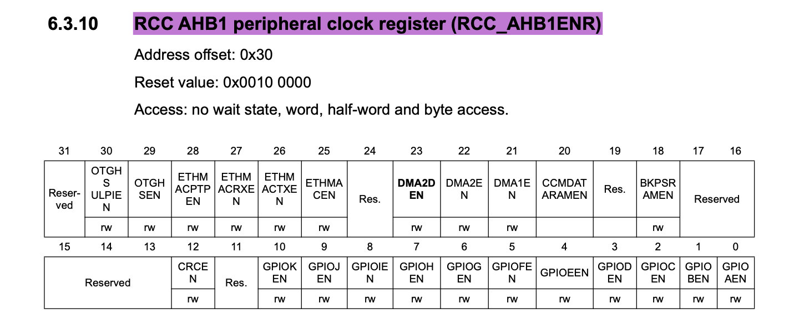
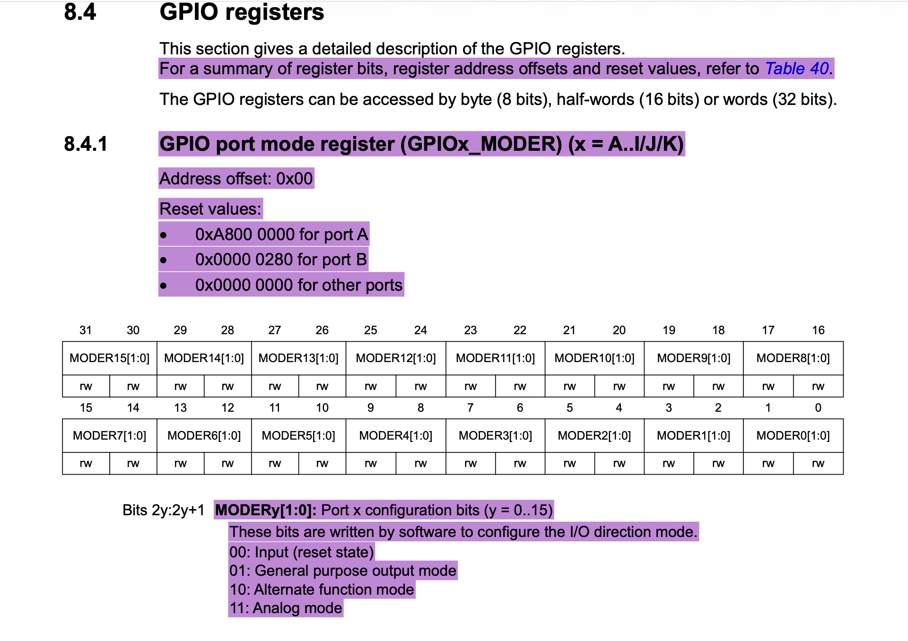
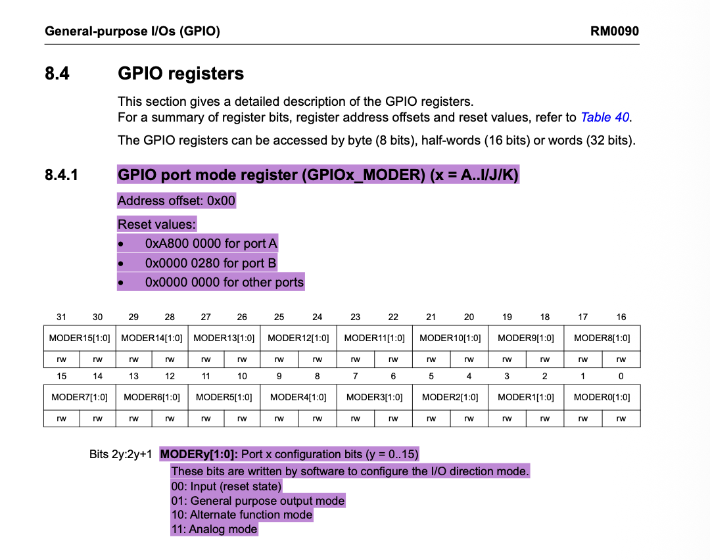
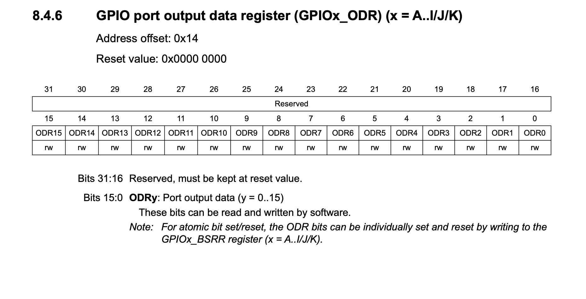
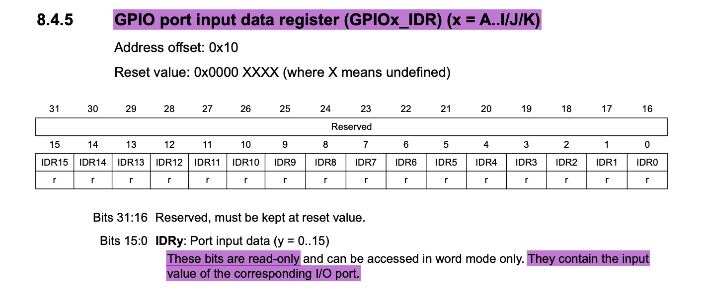

## 01_Interrupts_NVIC_practicals (STM32F407_Interrupt_Practicals)

Recording actual register-level experiments, C code, debugger observations and screenshots all without HAL. 

Before doing any practical experiments, to understand the basic terms of circuit diagrams, file [01_Basic_Electrical_Concepts](../01_Fundamentals/01_Basic_Electrical_Concepts/01_Basic_Electrical_Concepts.md) would be helpful.

### Goal:
Create an external interrupt when the User Button B1 is pressed. When B1 is pressed, the onboard LED should light up.


**Board:** STM32F407G-DISC1
**Language:** C
**Approach:** Bare-metal, register-level programming, without HAL and No LL


Before using interrupts, will make the onboard LED respond to the USER button using polling because a working baseline is required. This helps to verify that the GPIO input and output are configured correctly before introducing interrupts.

### Project 1: 
#### GPIO Polling

First experiment :
-   Read the USER button using GPIO input.
-   Control the Onboard Green LED using GPIO output.
-   Use polling to check whether the button is pressed.

Once this works, polling will be replaced with an external interrupt.

**Hardware mapping:** STM32F407G-DISC1 User Manual, DocID022256 Rev 6.

|Component	| STM32 pin |
|-----------|-----------|
|B1 USER button	| PA0 |
|LED4 Green	| PD12 |
|LED3 Orange	| PD13 |
|LED5 Red	 | PD14 |
|LED6 Blue	| PD15 |

**Understanding the signal path:**

Input is the USER button B1, which is connected to PA0.
Output is the onboard green LED4, which is connected to PD12.

The basic signal path is, 
```text
B1 button -> PA0 (GPIO input) -> C program checks the input -> PD12 (GPIO output) Green LED ON
```
Before reading the button or controlling the LED, the respective GPIO peripherals(both input and output) needs to be configured.

### 1. Configure GPIOA — USER button input

#### 1. 1. Enable the GPIOA peripheral clock

The user Button B1 is connected to PA0. i.e, GPIO Port A, Pin 0 is connected to the User Button B1. So the Clock for this Port (GPIOA) needs to be enabled. The STM32F407 has a clock-control peripheral called RCC (Reset and Clock Control). GPIO peripherals need their clocks enabled before acccessing thier registers. This is done using the register ***RCC_AHB1ENR: Reset and Clock Control – AHB1 Peripheral Clock Enable Register.***

-   RCC — Reset and Clock Control.
-   AHB1 — Advanced High-performance Bus 1.
-   EN — Enable.
-   R — Register.

GPIOA, GPIOB, GPIOC, GPIOD and several other peripherals are connected to the AHB1 bus. For GPIOA, bit 0 of RCC_AHB1ENR controls its peripheral clock.




Therefore, we need to set bit 0 without changing the other register bits. ```c RCC->AHB1ENR |= (1U << 0);``` Detailed explanation of bitwise operations: [Mastering bitwise](https://github.com/MythiliSivasubramanian/embedded_systems_foundations/blob/sub/02_C_for_Embedded/03_mastering_bitwise.md).

#### 1.2 Configure PA0 as input

After enabling the GPIOA clock, we need to configure PA0 as an input. The GPIOA_MODER register, also called the GPIO Port Mode Register is used to set this port as Input. 

#### Understanding GPIO MODER:



The GPIO mode is configured using the GPIOA_MODER register. Each GPIO pin uses two bits in MODER. STM32F407 GPIO ports have 16 pins, numbered PD0 to PD15. And each pin uses two bits in MODER. Therefore, the GPIOD MODER register has 32 bits, 16 pins × 2 bits = 32 bits. Each pin supports four possible modes:

|Bits|	Mode|
|-----|-----|
|00	|Input|
|01	|General-purpose output|
|10	|Alternate function|
|11 |	Analog|

PA0 is controlled by bits 1 and 0 of GPIOA_MODER. To configure PA0 as an input, these two bits (bit 1 and bit 0) must be 00. We can clear both bits using ```c GPIOA->MODER &= ~(3U << 0);``` This ensures that bits 1 and 0 are both zero, without changing the other pin configurations.

**Result:**

PA0 MODER bits = 00
PA0 is configured as an input.

### 2. Configure GPIOD — Green LED output:
The Onboard Green LED is connected to PD12. 

#### 2.1 Enable the GPIOD peripheral clock
GPIOD is also connected to the AHB1 bus. Enable the GPIOD peripheral clock of GPIOD by using bit shifting in c.  We can enable the GPIO Port D by updating the respective bit (bit 3) of RCC_AHB1EN, since GPIOD is also connected to the AHB1 bus. Bit 3 of RCC_AHB1ENR controls the GPIOD peripheral clock. I.e Basically we want the bit 3 of this register RCC_AHB1EN to be set to 1, without changing the other bits of the register. In main.c,  eventually written as : `RCC->AHB1ENR |= (1U << 3);`. 
Detailed explanation in [Mastering bitwise](https://github.com/MythiliSivasubramanian/embedded_systems_foundations/blob/sub/02_C_for_Embedded/03_mastering_bitwise.md).

Understanding the bitwise operation:

 Let's break down the operation: RCC->AHB1ENR |= (1U << 3);
- 1U << 3 creates a bit mask with only bit 3 set. 
- |= performs a bitwise OR and writes the result back.
- Existing bits remain unchanged; bit 3 becomes 1.
Practical result: The GPIOD peripheral clock is enabled.

We use |= instead of simply writing RCC->AHB1ENR = (1U << 3);, because 
-   |= sets the selected bit to 1 while preserving the other bits of the register RCC->AHB1ENR
-   = clears the entire register bits and only sets bit 3 as 1. This affects the other bits, which has various other functionalities. 

So, after this instruction, ```c RCC->AHB1ENR |= (1U << 3);```, bit 3 of RCC_AHB1ENR is set (GPIOD clock enabled). 

#### 2.2 Configure PD12 as an output:

Enabling the peripheral clock does not automatically make PD12 an output. Need to configure the GPIO pin using the Mode Register ```GPIOD_MODER```. The relevant register is MODER (GPIO Port Mode Register).



**Understanding GPIO MODER:**
As discussued above "Understanding GPIO MODER", PD12 uses bits 24 and 25 of GPIOD_MODER.

Therefore, GPIOD's MODER register has 32 bits: 16 * 2 = 32 bits. Each GPIO pin uses 2 bits in MODER. Since each pin uses two bits, so for PD12, 2 * 12 = 24. So bit 24 and bit 25 of GPIOD_MODER corresponds to PD12. Therefore:
- Bit 24 = 0
- Bit 25 = 1
Together: 01 -> General-purpose output mode.

Basically,
-   We want to configure PD12 as an output. PD12 is controlled by bits 24 and 25 of GPIOD_MODER.
-   And we need those two bits to become 01.

The binary representation of decimal 3 is ```0000 0011``` The two rightmost bits are both 1. Binary 11 gives us two adjacent bits set to 1. Need a mask that targets exactly two bits: bit 24 and bit 25. So, shift 3U left by 24 positions: ```c (3U << 24)```.

The result could be:
bit 24 : 1
bit 25 : 1
All other bits : 0

Here, 3U is used instead of 1U, since 1U contains only one set bit. But two set bits are required in mask to target both PD12 mode bits. Next is that these both bits should become zero without affecting any other bits. Bitwise AND (&) with a negated mask (~). ```GPIOD->MODER &= ~(3U << 24);```  

~(3U << 24) creates a mask where:
- Bits 24 and 25 are 0.
- All other bits are 1.

**Clear both mode bits:**

Then we use bitwise AND (&) to clear only those two bits in the register. Desired mode for PD12 is 01. First, clear both bits:
```c GPIOD->MODER &= ~(3U << 24);``` 

**Set PD12 to output mode*:**
Our desired mode is 01.
Then set bit 24 ```c GPIOD->MODER |= (1U << 24);``` The result is:
- Bit 25 = 0
- Bit 24 = 1

Now PD12 is configured as a general-purpose output.
    
***Quick Notes:***
-   3U << 24 creates a two-bit mask targeting bits 24 and 25.
-   ~(3U << 24) prepares those two bits for clearing.
-   &= clears both bits without changing the others.
-   |= (1U << 24) sets bit 24 to 1.

#### 2.3 Control the Green LED output:

Configuring PD12 as an output does not automatically turn ON the Green LED.We need another register to control the output level, which is ***GPIOD_ODR (GPIO Port D Output Data Register)***

|Register	|Purpose |
|GPIOD_MODER	| Configures PD12 as an output |
|GPIOD_ODR	| Controls whether PD12 outputs HIGH or LOW |

**For example:**
```c
GPIOD->ODR |= (1U << 12);    // Set PD12 HIGH
GPIOD->ODR &= ~(1U << 12);   // Set PD12 LOW
```



-   MODER decides the pin's mode.
-   ODR controls the output level.
-   IDR (Input Data Register) is used to read the actual input level of a GPIO pin.
-   GPIOA_IDR (Input Data Register) to read the USER button(in polling)

To turn ON the Green LED, PD12 needs to be HIGH (1). To Set the Port D Pin 12 as 1 in GPIOD_ODR, set the respective bit (bit 12) in GPIOD_ODR as 1. 

```c GPIOD -> ODR |= (1U << 12)````
This instruction,
1. Creates a bit mask with bit 12 set to 1.
2. Uses bitwise OR to set bit 12 in ODR.
3. Preserves all other bits in the register.

***Result:*** PD12 is set to high (1), which turn on the onboard green LED.  

To turn OFF the Green LED, PD12 needs to be low (0). To Set the Port D Pin 12 as 0 in GPIOD_ODR, set the respective bit (bit 12) in GPIOD_ODR as 0 by using bitwise operations

```c GPIOD -> ODR &=  ~(1U << 12)``` This clears bit 12 while preserving all other bits in ODR. 

***Result:*** PD12 is driven LOW, turning OFF the Green LED.

After enabling Input pheripheral Clock (Port A) -> Set PA0 as Input in GOPIA_MODER -> Enable Output Pheripheral clock (Port D) -> set PD12 as Output in GPIOD_MODER -> Set and clear output values to turn ON and OFF of the output LED in GPIOD_ODR. 

Now, the CPU needs to read the user button state. GPIOA_IDR (Input data Register) holds that information. 



For PA0:
- Bit 0 = 1 -> input is HIGH. (Button is pressed)
- Bit 0 = 0 -> input is LOW. (Button is not pressed)

Need to read the current logic level for PA0 in GPIOA_IDR. But reading all 32 bits of GPIOA_IDR isnt required since only bit 0 is required, as the user Button B1 is connected to PA0. Suppose the register contains,

```text
GPIOA->IDR = 0000 0000 0000 0000 0000 0000 0000 0001
```
The LSB Bit 0 tells the electrical level at PA0, which is currently 1 (High), meaning that the button is pressed. So,

- PA0 is connected to B1 USER button.
- GPIOA_IDR reads the input pin.
- Bit 0 = 1 means PA0 is HIGH.
- On this board, B1 is active-high: pressing the button makes PA0 HIGH.
When released, PA0 is LOW (0).

If the User Button B1 (PA0) is 1(high/Button pressed), then the onboard LED PD12 needs to set high (1), which turns the LED ON.

```c
if(GPIOA -> IDR & (1U << 0))        // User button presssed / PA0 is 1(high) Only bit 0 (PA0) needs check
{
    GPIOD -> ODR |= (1U << 12)                               // turn LED ON (Set PD12 to 1(high)
}
```

1. GPIOA -> IDR reads the input data register.
2. (1U << 0) creates a mask that targets only bit 0.
3. & checks whether that particular bit is set.
4. If the result is non-zero, PA0 is HIGH (button pressed).
5. We set bit 12 in GPIOD_ODR, driving PD12 HIGH and turning ON the Green LED.
if condition treats any non-zero result as true.

Suppose the button is pressed and the LED turns ON. Then when the button is released, the LED should turn OFF. ie PD12 should be set to 0. ie, if PA0 is 0, then PD12 should be also 0.

When the instruction ```c GPIOD->ODR |= (1U << 12);```is executed, bit 12 is set to 1 which turns the LED turns ON. Now, when the button is released, PA0 becomes LOW. But the ODR register does not automatically know that the button was released. The output remains HIGH until program changes it. Therefore, it must explicitly clear bit 12 of Port D, ```c GPIOD -> ODR &=  ~(1U << 12)``` 

-   GPIOA_IDR tells the CPU what the button's current input level is.
-   GPIOD_ODR remembers the output level we have commanded.
-   Changing the input does not automatically change the output.

```c
if(GPIOA -> IDR & (1U << 0))        // User button presssed / PA0 is 1(high) Only bit 0 (PA0) needs check
{
    GPIOD -> ODR |= (1U << 12);                               // turn LED ON (Set PD12 to 1(high)
}
else                     // Button not pressed / PA0 is 0(low)
{
    GPIOD -> ODR &= ~(1U << 12);            // Turn LED OFF (Clear PD12)
}
```

The above if else runs only once, ie, the instruction check only once if the button is pressed or no. But the CPU needs to check continously to read if the user button is pressed or not and accordingly the respective sub instructions (turn LED ON and LED OFF) needs to be executed. We need to continuously monitor PA0. while(1) makes the CPU repeat the button-checking logic indefinitely.This technique is called as **Polling**. Hence while(1), a infinite loop is required to check continously. So,

```c
while(1)
{
    if(GPIOA -> IDR & (1U << 0))        // User button presssed / PA0 is 1(high) Only bit 0 (PA0) needs check
        {
            GPIOD -> ODR |= (1U << 12);                               // turn LED ON (Set PD12 to 1(high)
        }
    else                     // Button not pressed / PA0 is 0(low)
        {
        GPIOD -> ODR &= ~(1U << 12);            // Turn LED OFF (Clear PD12)
        }
}

```

#### GPIO Polling Sequence:
```text
1. Initialise GPIOA
    Enable clock -> Configure PA0 as input

2. Initialise GPIOD
    Enable clock -> Configure PD12 as output

3. Poll continuously
    Read PA0 -> If HIGH, turn LED ON -> Otherwise, turn LED OFF

4. Repeat
    Keep checking the button inside an infinite loop.
```

### Program Structure: 
```c
#include <stdint.h>

int main(void)
{
    // 1. Enable GPIOA clock 
    RCC -> AHB1ENR |= (1U << 0);

    // 2. Configure PA0 as input
    GPIOA -> MODER &= ~(3U << 0);

    // 3. Enable GPIOD clock
    RCC -> AHB1ENR |= (1U << 3);

    // 4. Configure PD12 as output
    GPIOD -> MODER &= ~(3U << 24); // clear bits
    GPIOD -> MODER |= (1U << 24); // Set bits

    // 5. Continuously monitor the USER button Polling
    while (1)
    {
        if (GPIOA -> IDR & (1U << 0))
        {
            // Button pressed: turn Green LED ON
            GPIOD -> ODR |= (1U << 12);
        }
        else
        {
            // Button released: turn Green LED OFF
            GPIOD -> DR &= ~(1U << 12);
        }
    }
}
```