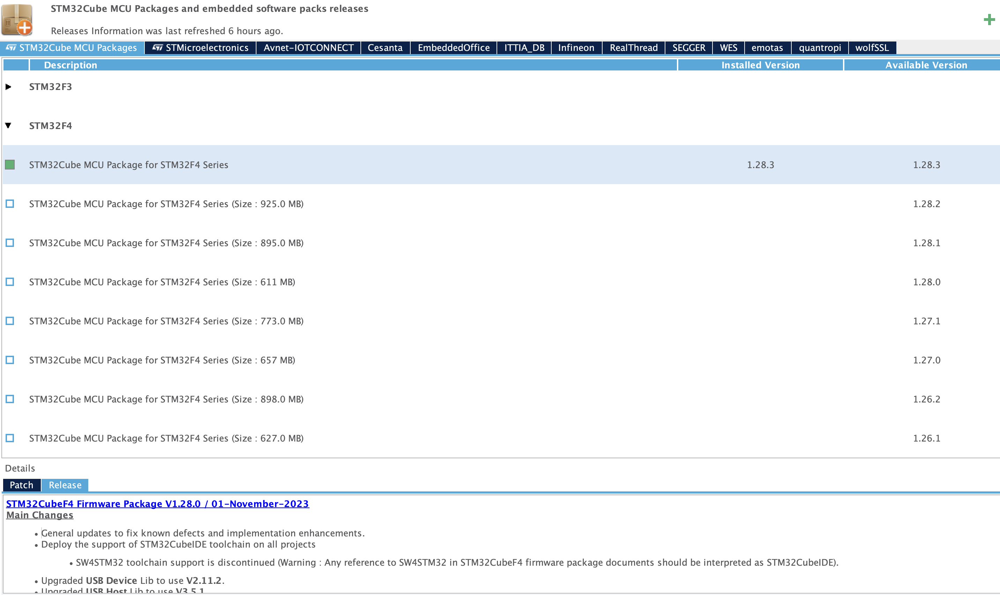
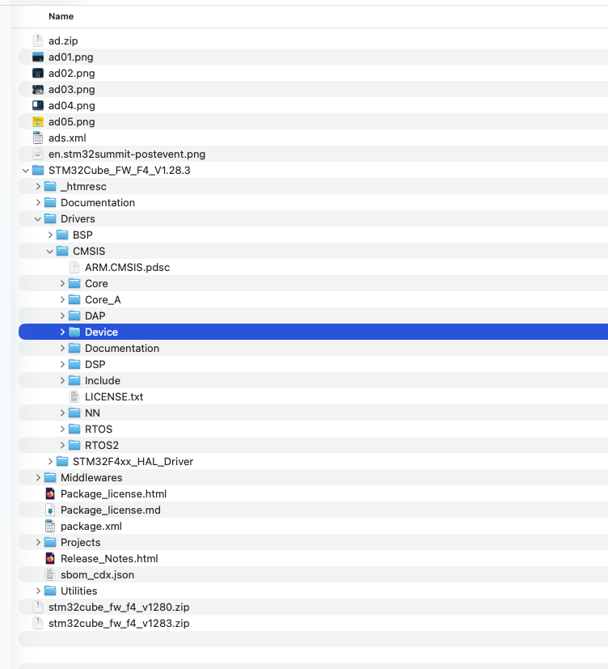
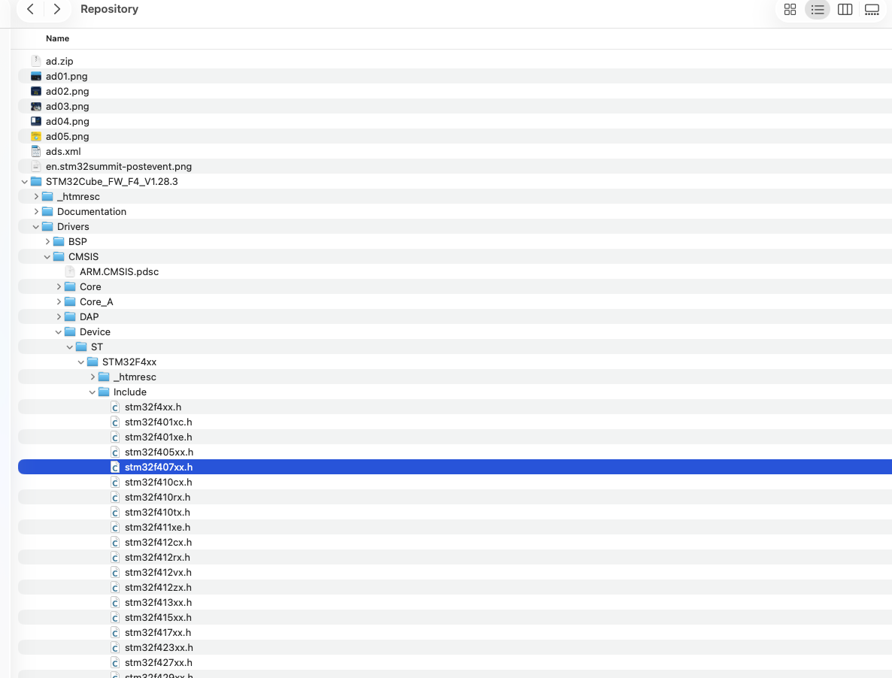
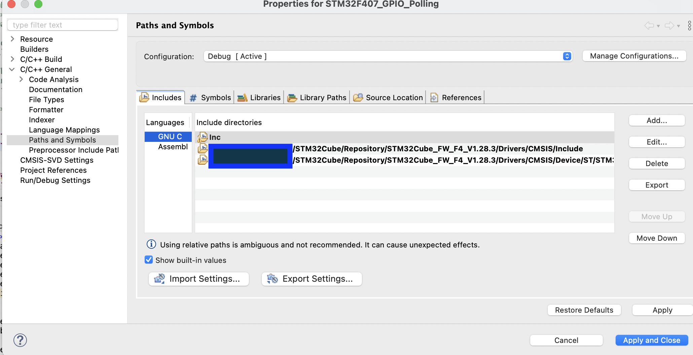
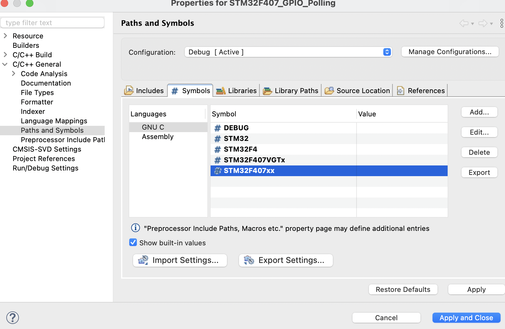
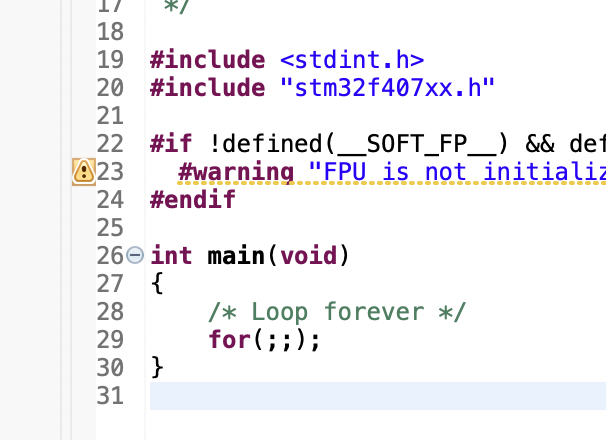

## Setting Up CMSIS for a Bare-Metal STM32F407 Project

Date: 25 November 2026

### 1. Goal:

I created a new project called `STM32F407_GPIO_Polling` for practising GPIO polling on my STM32F407G-DISC1 board. Refer file [02_STM32F407_Interrupt_Practicals.md](stm32-learning/docs/04_Interrupts_NVIC/02_STM32F407_Interrupt_Practicals.md)
My intention was to write C code to:

- Read the USER button (B1) connected to PA0.
- Control the Green LED (LD4) connected to PD12.
- Check the button continuously using polling.
- Turn the LED ON when the button is pressed and OFF when released.

Before writing the actual GPIO code, I needed to make sure that my project could access the STM32F407 hardware registers.
For example, I wanted to write:

```c
RCC->AHB1ENR |= (1U << 0);
GPIOA->MODER &= ~(3U << 0);
```

But where do `RCC`, `GPIOA`, `AHB1ENR` and `MODER` come from? The C compiler does not automatically know that these names represent hardware registers inside the STM32F407. So Header files that describe the MCU's peripherals, their registers and their memory addresses are required. This is where CMSIS comes into the picture.

### 2 CMSIS: 

CMSIS stands for **Cortex Microcontroller Software Interface Standard**. It is a standard developed by Arm for Cortex-M processor-based microcontrollers. STM32F407VG contains an ARM Cortex-M4 processor core. The STM32F407 also has several peripherals provided by ST, such as GPIO, RCC, USART, SPI, I2C, ADC and timers etc. To understand CMSIS, I first need to distinguish between the processor core and the microcontroller peripherals.

**A. Cortex-M4 processor core**

The Cortex-M4 is the processor inside our STM32F407. It has its own registers and processor features.

For example:

- MSP — Main Stack Pointer
- PSP — Process Stack Pointer
- CONTROL — Control register
- NVIC — Nested Vectored Interrupt Controller
- SysTick — System timer
- SCB — System Control Block

CMSIS Core provides standard definitions and interfaces to access these processor features. One of the important header files for our Cortex-M4 is, `core_cm4.h`

**B. STM32F407 device peripherals**

Apart from the processor core, the STM32F407 has its own peripherals.

For example:

- RCC — Reset and Clock Control
- GPIO — General Purpose Input/Output
- USART — Universal Synchronous/Asynchronous Receiver/Transmitter
- SPI — Serial Peripheral Interface
- I2C — Inter-Integrated Circuit
- ADC — Analog-to-Digital Converter
- TIM — Timers

These peripherals have registers at specific memory addresses. For example, GPIOA has a base address of `0x40020000`.

The STM32F407 device header provides definitions for the peripherals, their register structures and addresses, as well as device-specific interrupt numbers.

The header file for MCU is, `stm32f407xx.h`

**How do these two parts fit together:**

CMSIS Core provides the processor-level definitions, while the STM32F407 device header provides the MCU-specific peripheral definitions. Both are relevant to this project.

### 3. How CMSIS helps us access hardware registers

Let's take GPIOA example. GPIOA has a base address of: `0x40020000`  Its MODER register is at offset `0x00`. Without a device header, we would have to define the register addresses and structures ourselves.

The CMSIS device definitions already provide this information. That allows us to write, ```c GPIOA -> MODER ```. Instead of manually writing code to calculate the register address. Similarly, ```c RCC->AHB1ENR ``` allows us to access the AHB1 peripheral clock-enable register.

**Important:** Including a CMSIS header does not enable a peripheral clock or configure a GPIO pin. It only makes the required definitions and interfaces available to  C program. The hardware needs to be configured by writing the appropriate register values.

### 4. CMSIS vs HAL: 

Both are nit same. CMSIS and HAL are different. CMSIS provides processor and device-level definitions and interfaces. HAL (Hardware Abstraction Layer) provides higher-level functions to configure and operate peripherals.

For example, to enable the GPIOA clock:
**Using CMSIS device definitions with direct register access:** ```c RCC->AHB1ENR |= (1U << 0); ``` Here, I directly access the AHB1ENR register and set bit 0.

**Using the HAL library:** ```c __HAL_RCC_GPIOA_CLK_ENABLE(); ``` Here, I call a ready-made HAL function to enable the GPIOA clock.

I want to understand which register is accessed, which bit is changed and what happens inside the MCU.
Therefore, I am using CMSIS device definitions and writing directly to the hardware registers. I am not using HAL or LL in this project.


### 5. Installing the STM32F4 firmware package

When I initially created the project, I could not find the STM32F407 device header file. I also noticed that the `Inc` folder was empty. I needed to locate and install the STM32F4 firmware package to get the required CMSIS files.

I downloaded and installed STM32CubeMX. After opening STM32CubeMX, I followed these steps:

1. Opened `Install or Remove Embedded Software Packages`.
2. Selected `STM32Cube MCU Packages`.
3. Selected the STM32F4 Series package. The package description was `STM32Cube MCU package for STM32F4 Series`. The displayed package size was 925 MB.
4. Installed the available package version.

**Screenshot:** STM32CubeMX showing the STM32F4 package.


**My observation:**

The installed package folder was `STM32Cube_FW_F4_V1.28.3`

### 6. Locating the CMSIS header files

After installing the firmware package, I opened the following directory: `STM32Cube_FW_F4_V1.28.3/Drivers/CMSIS/`
Inside the CMSIS folder, I found two important directories.

**A. CMSIS Core Include**

Path: `Drivers/CMSIS/Include`

This folder contains the Cortex-M processor core header files. For Cortex-M4, one important file is, `core_cm4.h`

**B. STM32F4 Device Include**

Path: `Drivers/CMSIS/Device/ST/STM32F4xx/Include`

This folder contains the STM32F4 device-specific header files. Inside this folder, I found, `stm32f407xx.h` This is the device header we need for STM32F407VG.

**Screenshot:** CMSIS folder showing the `Device` and `Include` directories.


**Screenshot:** STM32F4xx Include folder showing `stm32f407xx.h`.



### 7. Adding CMSIS include paths to STM32CubeIDE

Now I had the required header files, but they were located inside the firmware package. The compiler needs to know where to find these files when it processes an `#include` statement. Simply having the files somewhere on my computer does not automatically make them available to the project. I needed to add their directory paths to the project configuration.

I followed these steps:

1. Opened STM32CubeIDE.
2. Right-clicked the project `STM32F407_GPIO_Polling`.
3. Selected `Properties`.
4. Opened `C/C++ General`.
5. Selected `Paths and Symbols`.
6. Opened the `Includes` tab.
7. Selected `GNU C`.
8. Clicked `Add`.

**First include path:**

`STM32Cube_FW_F4_V1.28.3/Drivers/CMSIS/Include` This gives the compiler access to the CMSIS Core header files.

**Second include path:**

`STM32Cube_FW_F4_V1.28.3/Drivers/CMSIS/Device/ST/STM32F4xx/Include` This gives the compiler access to the STM32F4 device header files, including `stm32f407xx.h`. After adding both paths, I clicked `Apply` and `Apply and Close`.

**Screenshot:** STM32CubeIDE Paths and Symbols showing both include paths.



### 8. Defining the target MCU

Next, I needed to tell the CMSIS device headers which STM32F4 microcontroller I was targeting.I opened, `Properties -> C/C++ General -> Paths and Symbols -> Symbols`
Under `GNU C`, I clicked `Add` and entered: ```text STM32F407xx ``` and left the value empty. This is a preprocessor symbol.

The device header uses preprocessor conditions to select the correct device definitions. Defining `STM32F407xx` identifies the target device for those definitions.

**Screenshot:** STM32CubeIDE Symbols tab showing `STM32F407xx`.



### 9. Including the STM32F407 device header in main.c

After configuring the include paths and defining the MCU symbol, opened `main.c` and added the following line:

```c
#include <stdint.h>
#include "stm32f407xx.h"
```

`stdint.h` provides standard integer types such as `uint8_t` and `uint32_t`. `stm32f407xx.h` provides the STM32F407 device definitions.

Now I can use peripheral names such as `RCC`, `GPIOA` and `GPIOD` in my C code without manually defining their addresses and register structures.

**Screenshot:** `main.c` showing both include statements.



### 10. Building the project — verification

After adding the header, saved `main.c` and selected, `Project → Build Project`. I wanted to check whether the compiler could find and process the STM32F407 device header correctly.

**My observation:**

Build finished successfully.

- Errors: 0
- Warnings: 1 (FPU initialization warning)

The compiler was able to find the device header and compile the project.

The FPU warning is separate from our CMSIS include-path configuration. I have not investigated or resolved it yet because our current GPIO polling program uses integer operations and not floating. 

### 11. What I understand now

- CMSIS stands for Cortex Microcontroller Software Interface Standard.
- CMSIS Core provides definitions and interfaces for Cortex-M processor features.
- The STM32F407 device header provides definitions for MCU-specific peripherals and registers.
- `core_cm4.h` is an important Cortex-M4 core header.
- `stm32f407xx.h` is the device header for our STM32F407.
- Include paths tell the compiler where to find the required header files.
- `STM32F407xx` identifies the target device to the conditional definitions in the device headers.
- Including a header does not configure or enable the hardware. I still need to write the register-level C code.

CMSIS is broader than just these two header folders. It includes other components and files too. For this particular bare-metal GPIO project,  using the CMSIS Core and STM32F4 device definitions only; Not using the entire STM32 firmware package.

Now that the project can access the STM32F407 device definitions, I can start configuring the actual GPIO hardware. Refer file [02_STM32F407_Interrupt_Practicals.md](stm32-learning/docs/04_Interrupts_NVIC/02_STM32F407_Interrupt_Practicals.md) and [Interrupts_NVIC_Theory.md](../04_Interrupts_NVIC/01_Interrupts_NVIC_theory.md) and refer this file for [STM32_GPIO_Polling_Project](Projects_STM32/Interrupts_NVIC/Polling/STM32F407_GPIO_Polling/Src/main.c) 

